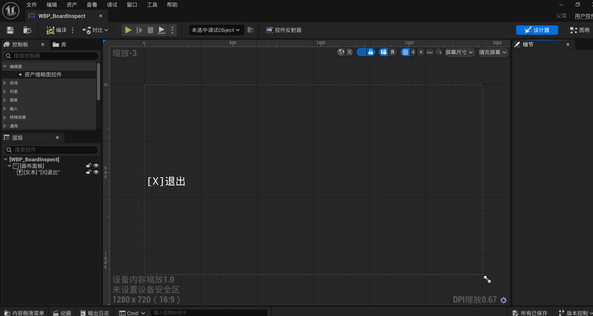

# 告示牌检查退出提示

更新日期：2026-09-20（Asia/Shanghai）。

本文件记录 `WBP_BoardInspect` 的当前真实用途。它是一个极小的检查状态提示层，不是告示牌内容页，也不是独立玩法界面。

## 当前资产证据

- 用户确认：玩家查看告示牌时显示该提示，当前只有“`[X]退出`”文字。
- 它不展示委托内容、不处理接取、不保存检查结果，也没有额外玩法功能。
- `APlayerCharacter` 进入检查状态时创建检查 Widget，退出检查时移除；视角、输入和真正的退出行为由玩家检查流程负责，不应塞进这行文字。
- 截图中的按键和排版是当前状态，不代表最终输入映射、手柄提示或视觉样式已经定案。

## 明确不包含

- 不把它升级成委托详情、教程、线索提示或交互菜单。
- 不修改 `WBP_BoardInspect`、玩家检查代码、输入配置或告示牌资产。
- 若以后要统一键鼠/手柄提示，应建立独立实现任务并在 PIE 中验证实际输入来源。

