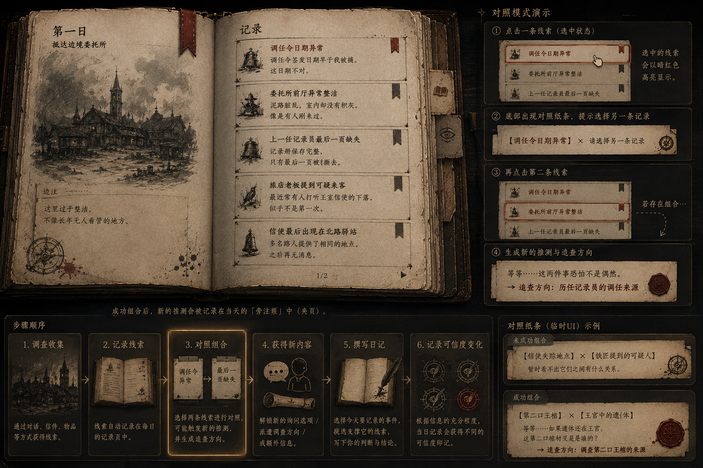
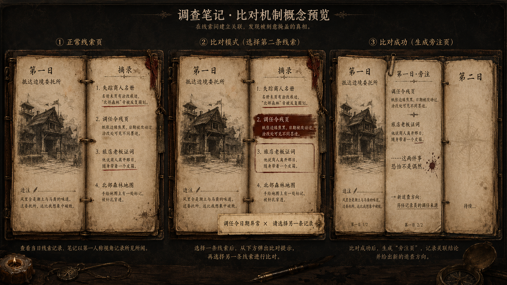
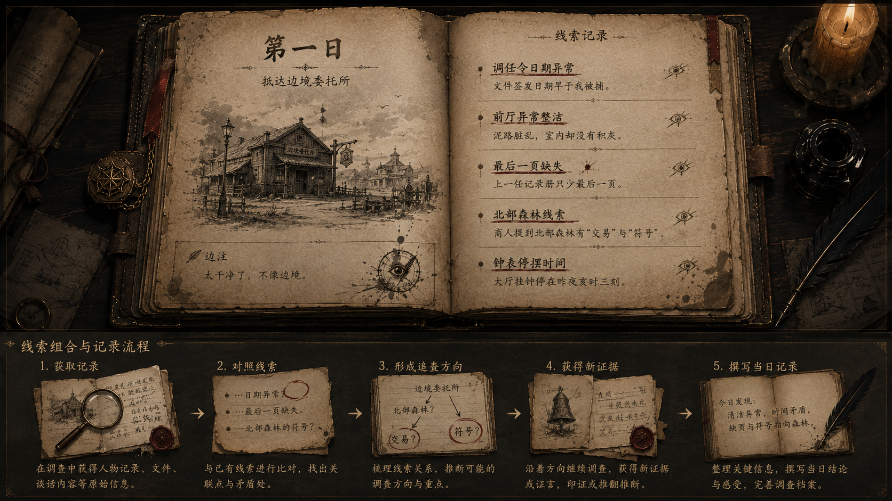

# 线索组合与推论 UI 概念

更新日期：2026-09-20（Asia/Shanghai）。

本文件记录线索组合的概念图，并区分当前已经实现的组合能力与尚未实现/验收的视觉体验。

## 概念证据

三张图表达同一方向：玩家先从真实来源获得记录，在记录本中选择两条线索进行对照；匹配成功时形成一条推论/旁注并给出新的调查方向，失败时给出“暂时看不出联系”的可理解反馈；推论可进一步影响对话、调查、派遣告知或每日撰写。

## 当前已经实现的能力

- `UPlayerNotebookWidget` 已有选择线索、等待第二条、比较、失败和形成推论等状态，并提供对照提示、线索组合文本、推论文本与调查方向的展示绑定。
- `UClueSubsystem` 能要求两条线索都已收集，按无序二元组合匹配 `UInferenceDefinition`，拒绝相同线索和无匹配组合；成功推论幂等保存，并记录首次解锁日和产生的叙事事实。
- 当前自动测试覆盖正式 Catalog 中的双线索匹配、反向顺序、重复解锁幂等、相同线索拒绝和无匹配拒绝。

因此可以说“线索组合的功能基础已经实现”，但不能说概念图的完整体验已经完成。

## 概念图尚未证明完成的部分

- 书页翻动、旁注页生成、对照纸条动画和视觉层级；
- 推论成功后具体开放哪条对话、派遣方向或新证据，以及玩家如何看见这个因果；
- 失败反馈是否允许快速换第二条线索，是否保留第一次选择；
- 推论和每日撰写的可信度印记如何关联；
- 大量线索时的筛选、来源、日期、关联人物/委托和避免盲试的提示。

## 设计边界

- 组合得到的是玩家的推论或调查方向，不是系统宣布客观真相。
- 失败组合应提供可理解反馈，但不应直接揭示唯一正确配对。
- 当前数据合同要求一条推论精确关联两条线索；若未来需要三条以上、链式推理或可修正推论，必须另立设计和数据迁移任务。
- 不修改记录本、线索/推论 DataAsset、动画、素材、正式文本或规则实现。

