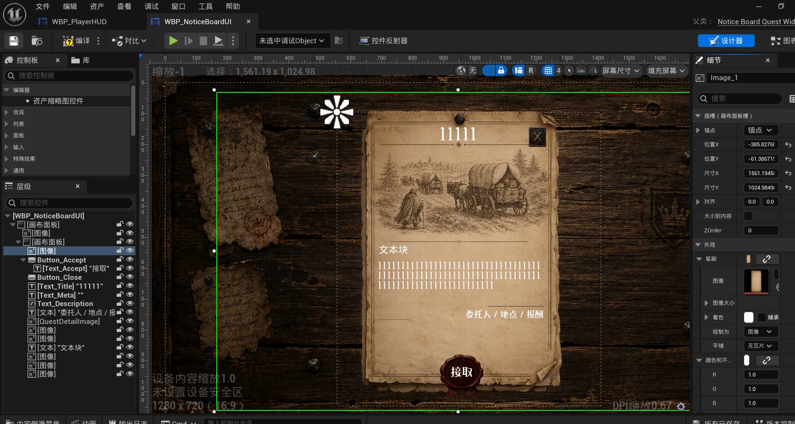
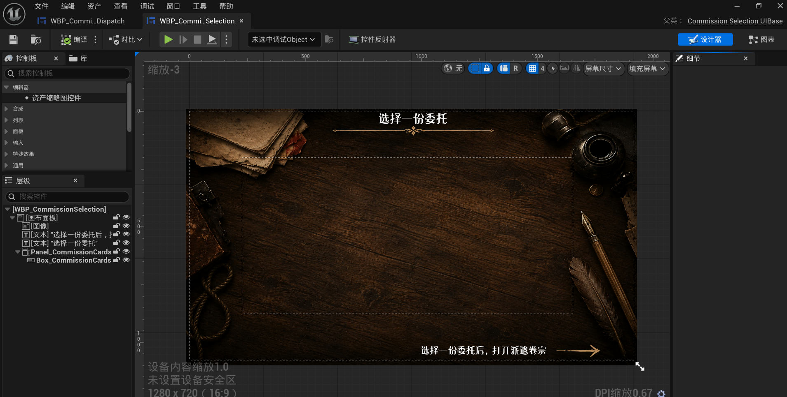
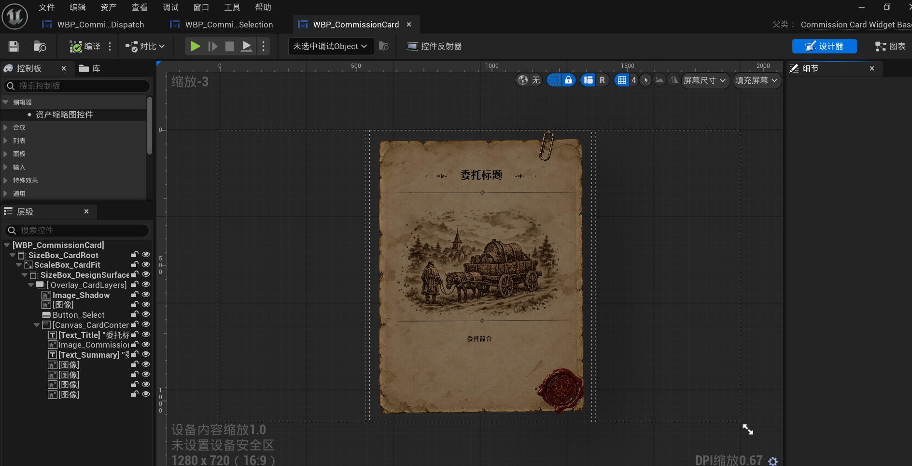
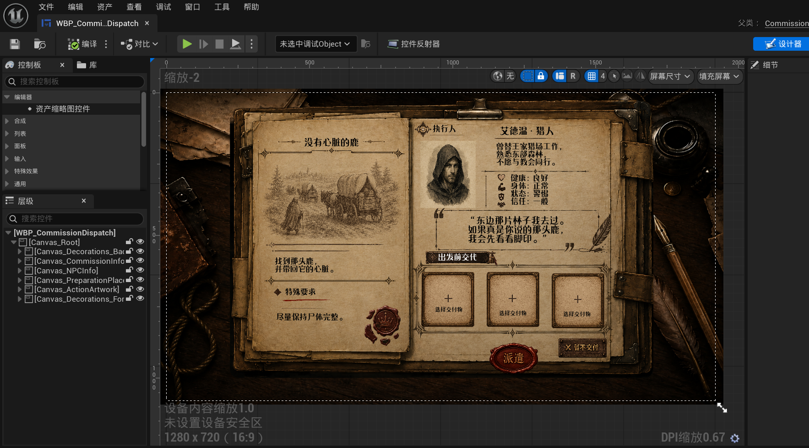

# 委托公告板与线索发现体验记录

<a id="dispatch-preview-data-current"></a>
## 派遣预览数据当前确认（2026-10-29）

用户追加出发反应（2026-10-29，已实现并验证、用户已确认）：三份委托分别使用用户提供的三句原文，唯一内容见[文本批次preview_reactions](../story/batches/2026-10-29-dispatch-preview-reuse.json)。Entry.PreviewReactionText非空只覆盖编辑器瞬态委托；正式DA/记录本不写。反应文字在原框动态缩字号，不删内容、不动装饰。[三份最新卷宗与台词实图](../evidence/2026-10-29-dispatch-reaction/README.md)已替代下方初次填数据时的空白反应图作为当前工作区入口；用户本次已确认，作为当前局部验收参考。Development/DebugGame构建及最终5项验证通过。


用户本轮要求：三份委托使用记录本后三条——消失的商队、被墨水涂掉的村庄、修复北路路标；NPC统一罗兰·格雷夫。每份委托共用九件可选交付物，图名沿用现有九物品、说明沿用用户已提供内容。两个预览按钮独立，仅共享测试引用，不从记录本复制运行态，不改正式委托/NPC/物品DA、背包、结算或存档。

- 当前输入：本机CommissionPreviewAssets三行；[唯一数据批次](../story/batches/2026-10-29-dispatch-preview-reuse.json)保存九名称/简介/图引用。AvailableCount=1只是预览可选样例。
- NPC四项：罗兰资产的受伤/警惕/陌生；身体难以胜任由本派遣条目独立模拟开关提供，不按健康计算，不依赖记录本按钮。
- 当前工作区：配置、独立身体模拟及原框动态字号已实现。长卡名单行缩放、罗兰简介完整保留；位置/装饰保持。Development与DebugGame构建成功，最终5项验证通过（含记录本实际渲染）；[当前实际图/证据](../evidence/2026-10-29-dispatch-preview-reuse/README.md)，用户本次已确认局部效果。
- 当前布局参考：[本轮用户选择页](../evidence/2026-10-29-dispatch-preview-reuse/Before_Selection.png)、[卷宗](../evidence/2026-10-29-dispatch-preview-reuse/Before_Dossier.png)、[交付表](../evidence/2026-10-29-dispatch-preview-reuse/Before_Delivery.png)。用途仅布局；图中旧三委托/测试执行人/四件物品的数据已被本次目标替代，不可按旧图恢复。
- 当前实际图主入口：[三卡](../evidence/2026-10-29-dispatch-preview-reuse/Selection.png)、[罗兰卷宗](../evidence/2026-10-29-dispatch-reaction/Dossier_1.png)、[九物品清单](../evidence/2026-10-29-dispatch-preview-reuse/Delivery_First.png)。这是用户本次确认的局部预览版本。
- 当前局部验收基线已按用户本次“可以了”建立；当前验收证据与差距见[本轮交接](../handoffs/2026-10-29-dispatch-preview-reuse.md)。记录本黄底/红线验收基线保持，不由本轮派遣数据修改覆盖。

以下日期段落为此前阶段记录；其中测试数据与未做状态不能覆盖本节当前确认。

## 2026-10-09 派遣选择页当前交互与装饰

用户确认：点击委托纸卡直接打开对应派遣卷宗；从卷宗返回时保留选择，右侧“查看派遣卷宗”文字或三角箭头可重开，左侧“返回”在独立预览中退出。用户自带的顶部整条纹样居中，底部三角箭头可交互、长线仅装饰。实现与自动验证已更新，原生 PIE 视觉/手感尚待用户验收；正式游戏入口左箭头去向未在本步接线。详情与证据见 [UI-DISPATCH-001 当前交接](../handoffs/2026-10-08-ui-dispatch-001-asset-organization.md)，下方早期原型段落保留为历史，不再代表现行按钮语义。

## 2026-10-08 派遣页面素材整理（待用户收尾复看）

用户认为当前视觉基本成形，要求把装饰素材和弃用方案整理后再复看。`Quest` Widget 目录原九张纹理均被使用：八张选择页标签纸/分隔线/小纹章通过 UE 资产接口移至 `Content/UI/Commission/PreparationSelection/Decorations/` 并改语义名，槽间竖线移至 `PreparationSlot/OriginalOrnament/`；同名 PNG 副本、旧名映射在目录 README。零当前蓝图引用的旧准备槽纸张v1–v5、旧印刷图/角花/普通框共15件归入项目根 `AssetArchive/UI/Commission/PreparationSlot/Deprecated_20261007/`，非删除。当前自带夹纸卡及仍被引用的隐藏夹子层保留。Development通过，真实RHI直接相关11/11通过；宽组有一项10-05已有的旧列表行测试失败，不把派遣业务或整页人工验收标为完成。最新1920×1080清单视角见`Saved/Automation/CommissionDeskPan/Sheet_1920x1080.bmp`。

## 2026-10-07 已填物品纸卡替换

用户指出旧纸张材质违和。旧v1竖版源图被拉成近方形，重破损、花角和卷边过强。首轮物品卡使用v3透明纸张纹理，Canvas宽高约0.86，保留原夹子、物品图、名称和点击；阴影复用纸卡轮廓。v2较明亮平整的候选及v1原图保留。v3实图后保存为`Saved/Automation/CommissionDeskPan/PaperCardV3.png`，v2对照`PlainCardV2.png`；首轮Development、真实RHI定向8/8通过。后续用户指出v3仍太亮，见下方续轮。

2026-10-07续轮：用户实图反馈v3仍过亮、像纸板卡片，曾换为更暗且有纤维、斑驳折痕、不规则薄边的v4纸张纹理；此版现已被用户新素材取代。v4实图保留为`Saved/Automation/CommissionDeskPan/PaperCardV4.png`，v3对照`PaperCardV3.png`；当时Development及独立真实RHI定向8/8通过。

2026-10-07最终候选：用户提供的新透明纸张自带金属夹，中央信封已由内置图像编辑去除，256×320空白版本当前绑定已填物品卡及阴影；原独立夹子透明度0，避免双夹。v4旧实图改存`PaperCardV4.png`；当前实图`FilledSelected_NoCornerBleed.png`。物品图、名称仍为独立UI层。Development与独立真实RHI定向8/8通过；用户审美待验收。

## 2026-10-07 已填纸卡红角穿层修正

用户实际截图显示已填绷带纸卡边缘露出空槽红角。原因：四角图层Z8高于纸卡Z3，运行时即使`bHasItem`仍给四角选中/悬浮透明度。现空槽仍按原有选中/悬浮显示红角；已填纸卡的四角透明度为0，清空后自动恢复。单行运行时修改，未改Widget层级或素材；真实RHI实图`Saved/Automation/CommissionDeskPan/FilledSelected_NoCornerBleed.png`，定向8/8通过，原生用户窗口待复看。

## 2026-10-07 三格贴近与竖线边界

用户确认放大的近圆和原纹饰，进一步要求三格再近、竖线只在横纹内。父级三格行由670.938宽居中缩至651宽、每项左右Padding由3.5归零，单格仍约217×216.637且中心距由223.65缩至217。前两格分隔竖线的Y范围由.08～.98收至.18～.89，2px线盒在新格间边界居中。真实RHI第一格悬浮截图 `Saved/Automation/CommissionDeskPan/CompactGrid_HoverEmpty.png`，局部9/9通过，原生设计器/PIE视觉待用户复看。

## 2026-10-07 紧凑精致排列微调

保留原图细节，只在子 Widget 调整组合：圆弧宽跨度.85、高.80，按原可见轮廓补偿保持近圆；两横纹宽.91，仅稍宽于圆弧；四角贴近同组边界。已有单格217方形、三格左右Padding3.5未改。前两格分隔改用用户 `T_DeliveryOrnament_Divider_v1`，UV仅去透明余边、有效墨线约1.3逻辑像素，位于7px格间距中央，最后一格仍隐藏分隔。没有重绘 PNG 或改命中/事务。第一格悬浮真实书页截图 `Saved/Automation/CommissionDeskPan/CompactGrid_HoverEmpty.png`；定向8/8通过，原生窗口审美待用户复看。

## 2026-10-07 三格正方排版试入

按用户参考图，三格内容区各约 `216.65×216.64`，原左右各8的间距改为3.5，使相邻排布紧凑且不再拉成窄高格。原版圆弧 X 显示范围略收，上下横纹从跨格长线收至仅比圆弧略宽；独立子 Widget 预览设为217×217。原 PNG 未改，原生按钮/纸卡和竖分隔仍在。真实书页空态与填入/悬浮实图见 `Saved/Automation/CommissionDeskPan/PrintedCard_Empty.png`、`PrintedCard_FilledHoverEmpty.png`；用户原生窗口审美待确认。用户随后提供竖线 PNG，项目中已有对应未跟踪 UE Texture，当前尚未替换原生竖线。

## 2026-10-06 三格印刷布局

针对用户指出“圆像椭圆、三格缺少竖线且太分离”，已将原版主体纹饰在 Widget 内分为圆弧和上下横纹三个非命中图层；圆弧按原图可见轮廓校正，上下横纹延至相邻格缘，前两格右缘加淡墨竖分隔。原始 PNG 未改，填入后的物品卡仍独立。实际空态与混合态截图见 `Saved/Automation/CommissionDeskPan/PrintedCard_Empty.png`、`PrintedCard_FilledHoverEmpty.png`；悬浮单槽图在 `Saved/Automation/PreparationSlotVisual/PrintedGridFinal/`。Development、真实 RHI 定向8/8通过；宽回归73/79，6项其他区域/既有失败。用户原生窗口观感仍待验收。

## 2026-10-06 原版交付纹饰试入书页

用户提供的圆弧/横线及四角原图已无重绘地接入 `WBP_PreparationSlot`，源 PNG 与 UE Texture 在 `Content/UI/Commission/PreparationSlot/OriginalOrnament/`。四角仍是四个独立非命中图层，槽位按钮与填入后的实体纸卡不变；悬浮和选中可显示红角。真实书页证据：`Saved/Automation/CommissionDeskPan/PrintedCard_Empty.png`、`PrintedCard_FilledHoverEmpty.png`；独立控件多态在 `Saved/Automation/PreparationSlotVisual/OriginalOrnament/`。自动定向6/6通过；视觉是否比前版更符合纸面材质，待用户原生窗口验收。

## 2026-10-06 交付框设计器选取层级修正

为便于编辑槽框样式，`WBP_PreparationSlot.Canvas_SlotLayers.Image_Registration` 曾提升为 Z=20，仍为 `HitTestInvisible`；备份与作者日志见 `Saved/CodexBackups/PreparationSlotDesignerFrame_20261006_171805/`、`Saved/Logs/DesignerFrame-Apply.log`。**2026-10-07 复核：这不能让父级 `WBP_CommissionDispatch` 画布直接点选嵌套子 Widget 的内部图片。** 需打开 `WBP_PreparationSlot`，从其层级树选择具体纹饰；原父级直选目标仍未实现。

## 2026-10-06 放大与朱红四角

最终已保存并独立读回：Development成功，真实 RHI定向6/6通过；编号与外框装饰已分开。对照图 Saved/Automation/CommissionDeskPan/RedCorners_Final_Hover.png、RedCorners_Final_Pressed.png；用户人工审美仍待验收。

用户确认将框和纸卡约放大15%，保留三槽间距；悬停四角渐显红色、点击选中后保留、按下加深。新增独立灰度角花由 UI tint 控制，中间圆弧与外部装饰不染红。素材及完整提示词见 PrintedCard/README.md；实现/证据/备份见 handoffs/2026-10-06-ui-dispatch-001-red-corners.md。首轮自动6/6通过，但编号移出槽位碰到外框装饰；已修正锚点，正在最终复验，人工待验收。

## 2026-10-06 印刷空槽 / 实体物品卡

最终已保存并自动验证：Development 构建成功、真实 RHI 5/5 通过，空槽普通墨色已加深，实际书页混合态图见 Saved/Automation/CommissionDeskPan/PrintedCard_*.png。原生点击命中与状态差异通过定向检查，人工审美仍待验收。交接 handoffs/2026-10-06-ui-dispatch-001-printed-card.md。

UI-DISPATCH-001 正在试做。素材清单与完整生成提示词见 Content/UI/Commission/PreparationSlot/PrintedCard/README.md。普通态为空槽淡墨纹样、原生加号/标签、罗马槽号；悬停渐入暖光与加深墨色；按下收光、加号缩小，不下沉书页；填入后显示完整纸卡、铜夹、图标和名称。当前槽位与是否有物品分别控制。作者命令备份后只写准备槽 Widget 及新纹理；相关视觉证据需要重验，人工验收未完成。

## 2026-10-05 准备槽卷草试版撤回

用户在实图复看后否决新加的锻铁卷草动画与素材：核心问题是交付槽原框与周围装饰线过于相像，不能靠同风格纹样承担选中辨识。该叠层已从 Widget 和 Content 移除，旧红直角也未恢复；点击、按压和基础内陷仅作临时反馈。新选中框的形体/材质/位置尚未设计确认，不能把旧框或卷草方案视为已验收。实施与验证见 `../handoffs/2026-10-05-ui-dispatch-001-vine-removal.md`。

## 2026-10-01 底部双按钮槽概念

用户新预览中底部两个按钮有嵌入式五金承托，而当前 FolioHD 背景没有实体槽位。已生成透明无字双槽条与空白 FolioHD 的概念合成图，供用户判断材质、比例和位置；详情及路径见 `handoffs/2026-10-01-ui-dispatch-001-button-socket-preview.md`。图中不应烘入按钮文字/状态或物品列表。尚未入 UE，现有纸张和 Widget 均未改变。

## 2026-10-01 清单左侧阴影微调

按用户实机截图，将清单左侧贴桌阴影由 -12×-4 收至 -6×-2，并加深为深棕 alpha .42；右下阴影及卷宗不动。自动聚焦 13/13，原生窗口观感待复看。见 `handoffs/2026-10-01-ui-dispatch-001-left-shadow-closer.md`。

## 2026-09-30 清单左侧贴桌暗边

在已有右下阴影基础上，按用户原生窗口反馈为交付清单左侧加窄轮廓接触影，上缘仅轻微露出。只加到木桌与真实底板之间，左卷宗、纸张、文字、按钮、数据与交互未动。聚焦测试 13/13、开发侧清单渲染已检查；用户原生窗口接地感待复看。见 `handoffs/2026-09-30-ui-dispatch-001-left-shadow.md`。

## 2026-09-30 右侧清单阴影修正

用户指出卷宗已有贴桌感，但清单仍悬浮。仅将清单接触/柔影加深并适度外露，且修正阴影原来按整个 840×850 清单 Widget 而非 680×850 实际底板拉伸的问题；左侧卷宗阴影和内部 UI 保持不变。当前聚焦自动化 13/13，宽回归 71/74（3 项既有失败）；原生窗口外观仍待用户确认。见 `handoffs/2026-09-30-ui-dispatch-001-folio-shadow-tune.md`。

## 2026-09-30 卷宗与清单贴桌阴影

用户认为现行双底板有悬浮感，批准为卷宗和交付清单增加贴近桌面的深棕接触阴影及较淡短柔影。当前 `WBP_CommissionDispatch` 在移动木桌层中复用两张底板的透明轮廓作四个仅展示的阴影 Image，位于卷宗/清单底板下方；纸面、文本、交互及平移未动。UE 双视角自动渲染与卷宗聚焦 13/13 通过；宽 Widget 71/74 有三项既有失败。用户原生窗口的暗调、阴影强度和“放在桌上”的感觉仍待复看，不能把自动渲染当作审美验收。详情见 `handoffs/2026-09-30-ui-dispatch-001-contact-shadows.md`。

## 2026-09-30 派遣桌面三层素材定版整理

用户在 UE 中将连续木桌和左右装饰拆分为三张 Texture，提供原生运行截图并报告测试无问题。现行 `WBP_CommissionDispatch` 使用 `ChatGPT_图像_2026年9月30日_15_33_25` 木桌、`15_36_34` 左装饰、`15_36_42` 右装饰；卷宗仍用 `T_DispatchDossier_RingClip`，旁置清单用 `T_PreparationSelection_FolioHD`。三张桌面原 PNG 的本地副本与对应关系见 `Content/UI/Commission/Background/SourceArt/README.md`。原文以下 DarkDecor、Pan、Board、FolioV2/V3 段落是历史迭代记录，不再描述当前画刷。未被当前运行 Widget 引用的这些版本和独立概念边框已移出 Content、保存在本机 Saved 备份；自动验证及本地提交见 `handoffs/2026-09-30-ui-dispatch-001-material-cleanup-commit.md`。不把这一步算作物品数据接线或整条派遣完成。

## 2026-09-30 用户桌面原图试入 UE

用户提供新的 2172×724 桌面 PNG，并要求原样替换；它已原位覆盖 `T_DispatchDesk_DarkDecor` 的源 PNG、重导同名 Texture，现有 `Image_PanDesk` 画刷、平移与裁剪未改。`Dossier_1920x1080_UserDesk.bmp`、`Sheet_1920x1080_UserDesk.bmp` 是两个实际 UE 渲染证据。右侧墨水瓶/笔羽在整张源图中存在，但固定清单视角不会取景到画布最右缘，故清单画面只有木桌；用户若希望它们也入镜，需要单独授权重新构图或调整视角。自动验证 12/12 通过，原生 PIE 色调待用户确认。

## 2026-09-30 深色装饰桌面版本

现行 `WBP_CommissionDispatch.Image_PanDesk` 使用新 `T_DispatchDesk_DarkDecor`（2172×724）替代偏亮的纯木桌面；纹理保留旧参考的深暖棕木色及左纸堆/皮书/绳索、右墨水瓶/笔羽等边缘道具。连续桌面尺寸、16:9 裁剪、850 逻辑像素平移、卷宗和常驻清单未改。清单视角里道具从清单后局部露出，详细画面见 `Saved/Automation/CommissionDeskPan/Sheet_1920x1080_DarkDecor.bmp`；自动渲染存在明显亮化，实际 PIE 颜色和遮挡感须由用户确认。新桌面不意味着物品清单数据或派遣流程完成。

## 2026-09-29 卷宗与旁置清单成对材质 UE 预览

用户选择环形夹子双页卷宗预览（1558×1010），并要求搭配其高清竖版透明清单（2100×2996）在现有派遣桌面中看效果。`Image_BackgroundDossier` 与常驻 `Image_SelectionBoard` 已分别指向新的版本化 Texture；旧图均保留。只换美术画刷，不移动 NPC/委托信息、三槽、清单真实列表/详情及平移。UE 1920×1080 的初始与平移后画面在 `Saved/Automation/CommissionDeskPan/Dossier_1920x1080_RingFolioHD.bmp`、`Sheet_1920x1080_RingFolioHD.bmp`；自动化 11/11 通过，但用户外观审美和原生窗口操作待验收。自动夹具中大白块来自未绑定的图片占位，不是新素材不透明背景。此步骤不解决真实物品列表与派遣事务，也不意味着最终视觉定稿。

## 2026-09-28 派遣旁置空清单视觉小步

用户先后否决偏亮的手写单页和方格清单，认可旧概念中通栏物品条目的清楚层级，要求在独立档案夹底板上留宽列表，并将较暗素材实际放入 UE 看效果。现新增 `Content/UI/Commission/PreparationSelection/T_PreparationSelection_Board.png` 及同名 UI Texture（1242×1266，透明外沿、无文字/按钮），`WBP_PreparationSelection` 以独立 `Image_SelectionBoard` 使用它。空列表由真实 `Scroll_Preparations`（696×500 逻辑像素）承载，空状态/槽号/标题/返回仍是 UMG；旧纯色纸层和未使用的详情占位已移除。生成图只是一张可替换底板，未来物品条目必须由 Widget/data 生成，不能从该图推定物品系统完成。

当前自动渲染 `Saved/Automation/CommissionDeskPan/Sheet_1920x1080.bmp` 可供视觉对比，四分辨率和卷宗 10/10 通过。用户尚未在原生窗口确认色调、尺寸与返回按钮手感；设计确认、素材导入、自动验证和人工验收分开记录。相邻公告板、真实委托条件/结果、物品/背包/存档均未修改。

更新日期：2026-09-18（Asia/Shanghai）。

本文件记录 `WBP_NoticeBoardUI` 原型所表达的委托接取页面，以及它与线索收集/推论玩法之间的设计边界。它是设计记录，不是已经批准的 UI 重做方案，也不批准修改 Widget、素材、DataAsset 或线索代码。

## 当前原型证据



- 来源：用户提供的 Unreal Editor `WBP_NoticeBoardUI` 截图。
- 截图中可见木质公告板背景、中央委托纸张、标题、插图、描述文字、委托人/地点/报酬一行、关闭按钮和“接取”按钮。
- 截图中的 `1111`、`文本块` 等内容是占位内容，不能当作正式剧情或正式字段示例。
- 当前布局、美术、材质、字体、按钮反馈和信息层级仍属于原型；不能从这张图推断最终成品。

## 这页当前应该承担什么

### 接取页的职责

这页首先是“读懂一份委托并决定是否接取”的入口，而不是完整的调查面板。玩家至少需要知道：

1. 这份委托大概要求做什么；
2. 事件或地点在哪里；
3. 目前能看到的委托人、报酬或其他元信息；
4. 接取和关闭分别会发生什么。

它可以给玩家一个值得调查的起点，但不应在接取瞬间替玩家解释全部真相、列出唯一正确的准备组合，或把所有相关线索一次性展示成答案。

### 与线索系统的边界

当前设计把四个阶段分开理解：

```text
公告板详情：理解委托前提、决定是否接取
        ↓
阅读/观察/对话/报告：从真实来源获得线索
        ↓
笔记与线索页：查看已知事实、比较线索、形成推论
        ↓
派遣准备：选择 NPC、物品、线索或要告知的信息
        ↓
报告与后果：获得新的但不一定完整的信息
```

这不是要求最终一定使用五个独立界面，而是防止把“委托已接取”“线索已发现”“推论已成立”误当成同一件事。是否在公告板页增加少量关联线索入口，仍待实际流程验证。

## 当前代码映射（只描述现状）

- `UNoticeBoardQuestWidget::DisplayQuestInfo` 当前能把 `FQuestInfo` 的标题、描述、元信息和详情图映射到对应控件。
- `ANoticeBoard` 当前最多维护三个公告槽位；可用槽位显示，`AcceptQuest` 将可用状态改为已接取，并刷新公告状态和公告演员。
- `SetCommissionSlot` 可以从 `UCommissionDefinition` 的 `Presentation` 读取标题、摘要、描述、元信息、地点和图片；它不把运行时线索/推论状态写回委托定义。
- `UCommissionDefinition` 已有 `Leads`、分支条件中的 `RequiredClueIDs`/`RequiredLeadIDs`，但截图这条公告板详情路径没有一个专门的“已知线索/调查进度”视图。
- `UClueSubsystem` 独立保存线索来源、获得日期、委托关联、Lead 和 Inference；`ClueRichTextBlock`、线索记录控件和笔记页承担后续查看/选择入口。
- 截图中的“委托人 / 地点 / 报酬”是一个视觉意图。当前正式展示结构有 `Meta` 和 `Location`，但委托人、报酬尚未在公告板展示路径中拆成独立、可校验字段；不能在本轮擅自补数据合同。

## 线索发现体验：暂定目标

用户希望玩家能思考，但不能因为线索过于隐蔽或限制过硬，最后“玩到最后什么都不知道”。因此先记录以下**待验证的体验目标**，不将它们当成已确认机制：

1. **保留思考，不提前揭底。** 页面和线索页可以展示已知事实、来源和可继续调查的方向，但不直接标出唯一真相或标准答案。
2. **让玩家知道还有什么可做。** 未发现内容可以通过场景、人物反应、可读物、模糊的调查方向或“尚未理解”的状态被察觉；不要让关键线索只依赖像素级搜索或没有反馈的试错。
3. **避免无声死路。** 如果某个判断或线索缺失会影响结果，应明确显示“信息不足/尚未确认/可能的后果”，而不是让玩家因为不知道隐藏条件而永久失去理解机会。是否允许低信息结果、补救路径或默认结果，要由纵向切片决定。
4. **反馈来源和因果。** 玩家得到线索时应能知道它来自哪里、何时获得、与哪条委托或人物有关；推论成立时应能看到它改变了什么调查方向，而不是只出现一个无解释的解锁图标。
5. **不把接取变成强制解谜。** 接取委托不应自动要求玩家先找齐所有线索；当前 Demo 允许信息不完整时作出选择并承担后果。若未来某类内容确实有硬条件，条件、缺失原因和替代路径必须可理解。

这些目标还没有决定具体采用“关联线索预览”“分层提示”“线索回顾/追问”“低信息结局”等哪一种手段。先验证问题，再选择实现方式。

## 后续需要观察的问题

在至少一个可玩的 2～3 日纵向切片中，重点观察：

1. 玩家看完公告是否理解委托的基本前提，而不是误以为已经知道答案；
2. 玩家是否能分辨“接取委托”“获得线索”“组合推论”“派遣准备”四类行为；
3. 玩家卡住时，是因为需要思考，还是因为没有任何可见反馈；
4. 漏掉一条可选线索是否会导致完全无法继续或无法解释结局；
5. 公告页加入线索提示后，是否削弱探索和推理，或只是减少无意义的盲搜；
6. 关联委托、线索和推论的数量是否让页面信息过载。

## 明确不包含

- 不在本轮重做 `WBP_NoticeBoardUI`、`UNoticeBoardQuestWidget`、公告板 Actor 或笔记 UI。
- 不在本轮确定委托人、报酬、线索、Lead、Inference 的新字段或正式 DataAsset 内容。
- 不在本轮决定“必须集齐线索才能接取/派遣”或任何唯一正确解。
- 不把截图中的占位文字、视觉尺寸和当前按钮表现视为最终验收标准。
- 不修改已有工作区中的 Blueprint、C++、配置或 `.uasset`；这些既有修改继续保留。

## 后续重新评估与退出条件

当公告板、线索收集、笔记组合和派遣准备能由真实玩家连续体验时，再为每条委托定义：可见的已知信息、可追查方向、线索缺失反馈、是否允许接取/派遣、失败或低信息结果以及回顾入口。只有用户确认这些交互合同后，才建立独立实现子任务并修改 Widget 或数据结构。

## 派遣入口：先选择一份委托（2026-09-20）





用户补充：`WBP_CommissionDispatch` 的派遣流程首步，是在 `WBP_CommissionSelection` 中**选择一份委托**；`WBP_CommissionCard` 是该选择页生成的单张委托卡。这个入口和公告板的“接取”不是同一动作：公告板决定玩家是否把委托纳入可处理内容；派遣入口从当前可派遣集合中选定本次准备对象，之后才进入 NPC、物品、已告知信息或其他准备步骤。

当前静态实现与截图一致：选择页维护 `AvailableCommissions`、动态创建卡片，并在用户点击卡片后保存 `SelectedCommission`；卡片展示委托标题、插图和摘要，且可在悬浮时弱化其他卡片。截图中的“选择一份委托后，打开派遣卷宗”说明这一步的意图，但不能据此断言后续卷宗的页面顺序、是否允许返回、何时锁定出发快照，或卡片信息已经足够。

### 本页补充的边界

- 选择页负责“本次派遣处理哪份委托”，不是完整委托阅读页，也不替代公告板。
- 卡片是选择控件，不应在这里预先显示唯一正确 NPC、物品或线索组合；必要的风险/缺失信息如何提示仍待设计。
- 选择本身不等于确认派遣或消耗物品。真正锁定 NPC、准备物、已告知信息和跨日出发快照的时点，必须在后续确认步骤明确显示。
- 本轮只保存截图和记录入口顺序；未修改 `WBP_CommissionSelection`、`WBP_CommissionCard`、`WBP_CommissionDispatch`、委托数据或派遣逻辑。

## 已选委托后的派遣卷宗（2026-09-20）



用户补充的 `WBP_CommissionDispatch` 截图是“选择一份委托”之后的下一层界面，而不是又一个委托选择页。画面把本次处理对象放在左侧卷宗页：委托标题、插图、目标与特殊要求；右侧是当前执行人：姓名/职业、肖像、介绍、状态与出发前反应。下方可见三个“出发前交付”位置，以及“派遣”和“暂不交付”两个操作入口。

当前应把整条意图理解为：

```text
公告板接取
  → 派遣选择：选定本次处理的委托
  → 派遣卷宗：查看委托与执行人、决定是否/如何准备
  → 明确确认：锁定本次出发快照并派遣
```

### 已核对的现状与不能越过的结论

- `UCommissionDispatchUIBase` 能从委托和 NPC 定义映射标题、详情图、委托说明、特殊要求、NPC 姓名/职业、肖像、介绍、状态和预览反应；它明确是**展示层**，没有背包、接取、派遣或存档副作用。因此截图存在“派遣”视觉按钮，不能单凭此断言该 Widget 已自行完成派遣事务。
- 另有 `UCommissionUIBase` 提供统一派遣草稿：三个准备槽、可用准备列表、清空准备、派遣和返回按钮的运行时接口。它说明当前代码存在“三格准备”的实现边界，但不等于三格就是最终玩法容量或最终布局。
- “暂不交付”目前只确认是原型中的按钮文案，**语义未定**：它可能表示空准备仍然继续派遣，也可能表示返回/暂缓本次派遣。必须在真实纵向切片中先确定，不能提前把它写成默认结果、取消动作或资源消耗规则。
- 当前截图只展示一个已选执行人。是否先选 NPC、是否可换人、NPC 状态哪些字段可见、交付物能否包含线索/信息，以及哪一步才允许派遣，均仍待确认。
- 准备预览只能反馈作者配置的反应和可派遣性；隐藏分支结果 ID 不应在出发前暴露。截图文本、状态名和三个空槽都只是当前原型/预览证据，不能当作正式剧情或最终 UI 验收。

### 本页补充的边界

- 派遣卷宗是“看清本次选择并形成准备草稿”的界面，不替代公告板、笔记本线索页或最终报告页。
- 本轮不确定“派遣”“暂不交付”按钮的最终事务语义，也不确定空准备、缺失信息和低信息结果的处理；这些要与七日循环和报告后果一起试玩。
- 不在本轮重做 `WBP_CommissionDispatch`、接入交付物控件、改动 NPC/物品/线索数据、修改确认锁定逻辑或填写正式委托/NPC 文本。
