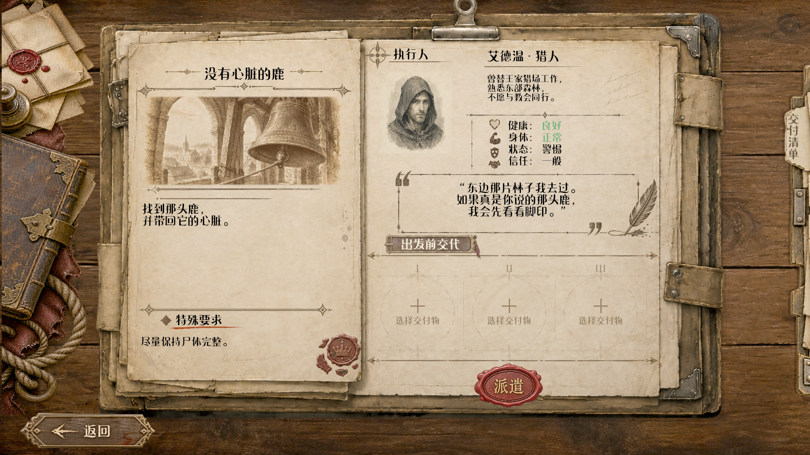
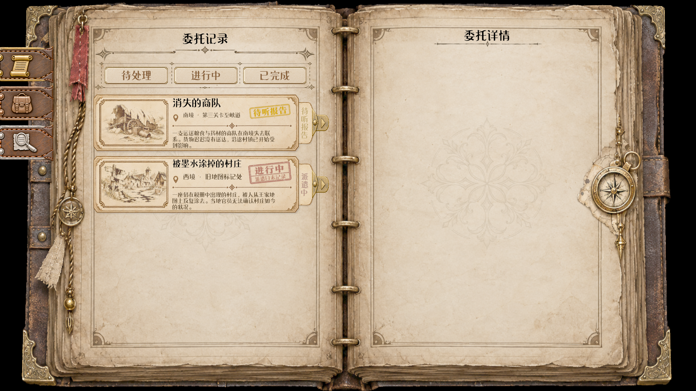
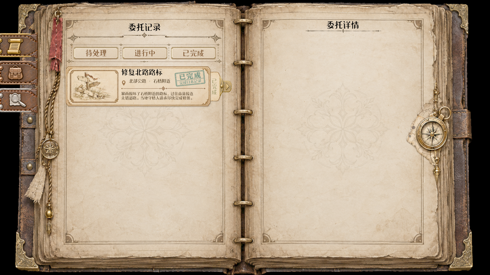

# 委托返回与报告入口概念

更新日期：2026-09-20（Asia/Shanghai）。

本文件记录委托返回后的报告表现方向。它连接 NPC 物理返回、听取/提交报告、记录本回看与后续叙事，但不在本轮确定最终事务按钮或界面布局。

## 概念证据

旧版派遣/报告截图仍保存在本目录，作为历史概念图，不作为当前布局依据。

## 用户确认的双入口方向

1. **与返回的 NPC 交谈。** NPC 返回后，玩家可以直接与对应 NPC 对话；报告应有实际提交/听取过程和相应表现，而不是后台自动把全部信息塞进记录本。
2. **记录本查看状态。** 玩家可在委托页看到已返回但未听取的“待听报告”提示；状态标签可点击查看进行中页面，只作只读提醒，不提前展示报告内容。首次听取必须找对应 NPC 对话。报告完成后已有读取已提交结果的只读回看实现；其存在不代表正式NPC首次报告流程已接通。

两条入口应访问同一份委托实例和同一份锁定结果，不能各自产生一份报告或重复授予线索、物品和剧情后果。第一次听取/提交、取消后重开、完成后的只读回看需要明确区分。

## 当前实现边界

- 委托子系统已经区分 Active、返回/等待报告、Reporting 与 Resolved，并支持开始报告、取消报告、完成结算和查询等待报告实例。
- 返回时可以先释放 NPC 占用并应用身体/状态变化；报告完成时才把报告信息和奖励提交给玩家，重复完成不会重复结算。
- 2026-10-28当前工作区核对：NotebookCommissionRecords已从正式实例和NPC读取、订阅状态变化刷新；ReadInstance仅在Resolved且效果已提交时显示报告。Association的Entry/Instance/LiveRefresh/ReadSources/Widget及AuthoredContent.ReviewedReport本轮通过。记录本来源/刷新/只读边界有证据，正式NPC首次对话、演出及端到端奖励流程仍未在本轮验证。详见[本轮交接](../handoffs/2026-10-28-original-thread-context-audit.md)。

## 待确认问题

- NPC 对话中首次听取报告的具体选项、演出与取消重开交互；记录本不发起首次报告；
- 报告过程中能否追问、退出后从何处继续，以及 NPC 离开或受伤时如何表现；
- 已完成报告在记录本中显示全文、摘要、所得线索还是三者分层；
- “待处理/进行中/已完成”与“未派遣/派遣中/待听报告/已解决”的实际列表映射及报告完成后的只读回看形式。

## 明确不包含

- 不修改 NPC 对话、委托子系统、记录本、报告数据、奖励/线索结算或 `.uasset`。
- 不把概念图里的鹿、艾德温、物品、日期和报告正文当作正式剧情内容。
- 不把“能查看报告”误报为“报告首次提交入口已经实现”。

### 以下为按日期保留的阶段记录

2026-10-20 UI交互补充：用户确认派遣中侧签点击可联动选中所属委托，先解决选择/命中问题；新的派遣或报告页面后续另行设计。本步不执行首次听取、报告结算、NPC交谈或只读报告回看；旧首次报告边界保持。选中A后点B标签由UI-NOTEBOOK-LIST-001局部实现与验证，不代表报告页面或事务已完成。
2026-10-23用户确认首次报告继续向NPC听取；当时要求先拆好派遣前/派遣中/已完成三种右页，用户后续自行设计布局。左页与公共外壳复用。当时结构设计待审阅、未实施；此状态已过期，当前三形态/侧签接入见上方实现边界及矩阵，不能将当时“未实施”当成当前结论。
2026-10-23报告玩法核对：2026-10-23已确认：对话来源的信息随玩家实际听到的内容被动收集；可阅读文本来源的信息由玩家点击指定文本内容主动收集。两类都不以真假或可信程度为收集门槛；获得线索不代表认可其判断，线索匹配仍是建立联系/形成推论。未触达的对话内容不能提前发放。同一线索重复获得不重复授予。此为设计确认，不代表所有正式文本入口已实现；报告回看中的文本与已听取信息如何对应仍需明确。 执行中相关见闻来源已由用户澄清为NPC的描述及与该委托相关的事件；报告回看与文本点击收集的关系仍待具体内容对应。此轮仅讨论/文档，三形态实现仍暂停。

## 2026-10-23 相关见闻澄清（用户已确认）

- 入口：玩家记录本里的委托标签，打开该委托对应页面。
- 内容：围绕该委托的相关信息，可以是NPC的描述，也可以是与委托有关的事件记录。
- 职责：汇总委托关联见闻，不能将其一律解释为执行人外出途中实时传回的消息，也不将它限定成现有线索列表。
- 展示沿用用户确认的两张参考图；此前用户已指出不把整块见闻做成像可展开的大按钮，交互对象落在具体内容上。
- 收集规则沿用已确认的来源区分：对话中实际听到的内容被动收集；文本中的指定内容点击收集，真假不设门槛。相关见闻记录与可收集线索的具体对应关系不由本次澄清擅自扩展。
- 此轮仅修正文档理解，不改代码/资产，不自动恢复已暂停的三形态拆分。引用对话工具仍仅返回最新部分用户发言/图片及助手占位，未声称读取到全部玩法讨论。
## 2026-10-23 调查所得以信息为核心（用户已确认）

- NPC对话是另一种线索获取渠道；对话中实际获得的信息被动收录到线索栏。
- 实物只是可能的信息载体，不要求每次派遣或每条描述都创建背包物品。鹿角可以没有实用物品用途，但关于鹿角的描述能作为线索。
- 若有实际交付物品，随对话交给玩家进入背包；不增加报告页手动领取步骤。允许纯信息结果，没有物品入包。
- 报告页可回顾发现及相应描述，不把图中的每一格证物默认当可领取物品。是否更名该区标题、具体图文排版仍未定，不把建议当用户确认。
- 对话自动收录与文本点击收录的规则保持；回看不重复发放线索/物品，也不能绕过首次NPC报告。
- 底层Outcome已有可选GrantedItems与GrantedClues维度，本次不新增物品类型、不修改DA/事务代码，不宣称报告UI已接通。

2026-10-25用户更新：待听报告是进行中分类内的过渡提示，不新增分页。使用提供的金色印章和金棕侧签；标签仍打开InProgress，不能从此开始/完成首次报告。当前FQuestInfo/隔离预览用Active有效的bAwaitingReport输入；正式实例自动适配仍不在本步。

