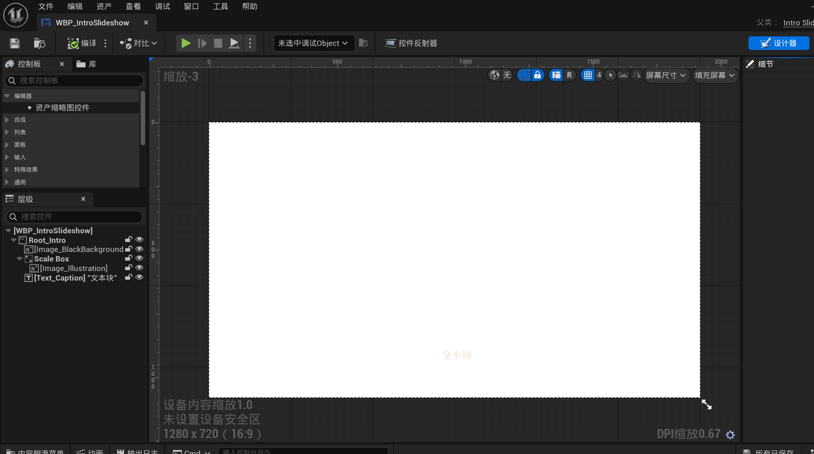
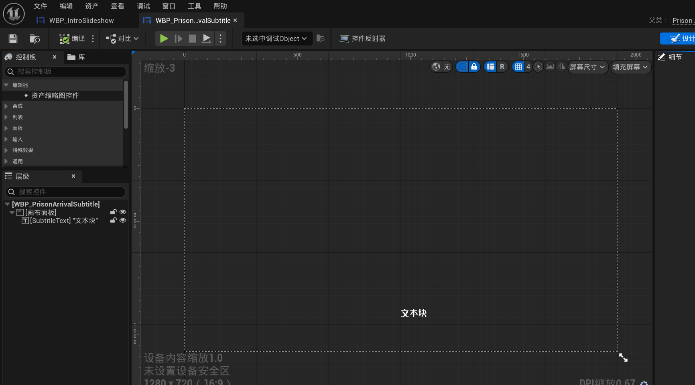
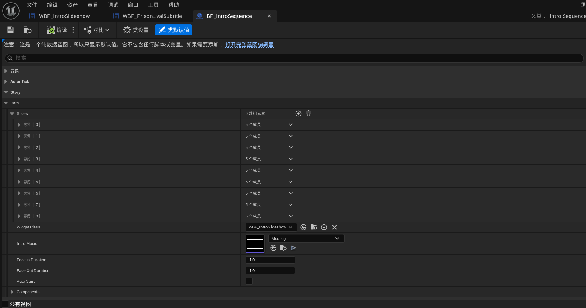

# 开场 CG、字幕与 Intro Sequence 设计记录

更新：2026-09-18（Asia/Shanghai）  
状态：早期原型记录 / 试验中，不代表最终剧本、镜头或 UI 定稿。

## 这次记录什么

本页把三类当前原型放在同一条入口体验里，但不把它们混成一个控件：

1. `WBP_IntroSlideshow`：开场 CG/插画幻灯片的画面容器，包含插画和开场字幕/旁白文字层。
2. `WBP_PrisonArrivalSubtitle`：囚犯抵达段落使用的独立字幕层，当前只确认“显示说话者与台词、隐藏字幕”。
3. `BP_IntroSequence`：把画面、字幕、声音、淡入淡出和镜头运动编排成一段可播放序列的数据资产。

这属于进入 Demo 的体验外壳，不是七日委托、派遣、线索或撰写循环的完成证明。本轮只归档用户提供的截图、已有实现边界和设计初衷，不修改 Widget、蓝图、声音、镜头或正式文本。

## 当前可确认的结构

### 开场 CG / 幻灯片

截图显示 `WBP_IntroSlideshow` 的早期容器：黑色背景、插画区域和 `Text_Caption` 占位文本。它应承载“看到什么、这一刻旁白/字幕说什么”的同一张画面，但截图中的插画和文字都是占位或早期内容，不能当作最终美术或剧情正文。

代码层的每个 `FIntroSlideData` 当前包含：插画、主字幕文本、静止停留时长、单张音效，以及可选的 `CameraBeats`。因此它不是单纯按固定时长切图；一张图可以有多个镜头节拍。

### 字幕层

`WBP_PrisonArrivalSubtitle` 是独立的字幕 Widget，目前暴露 `ShowSubtitle(SpeakerName, Line)` 和 `HideSubtitle()`。它更适合记录抵达过程中的角色台词或带说话者的信息，不应自动等同于 `WBP_IntroSlideshow` 内的叙事 caption。两者最终是否共用排版、是否区分旁白与角色发言，仍待文本和演出设计确认。

### 序列、声音与镜头

当前 `BP_IntroSequence` 截图能确认：

- `Slides` 当前配置为 9 个元素；每个元素显示为 5 个成员，和 `FIntroSlideData` 的插画、Caption、HoldDuration、SlideSound、CameraBeats 对应。
- Widget Class 指向 `WBP_IntroSlideshow`。
- Intro Music 指向 `Mus_cg`。
- 淡入和淡出时长当前均为 1.0 秒。
- 截图中 `Auto Start` 未勾选；这只记录当前资产状态，不替用户决定最终入口是否自动播放。

代码还支持：

- 每个镜头节拍用 `TargetOffset`、`TargetScale`、`MoveDuration`、`HoldDuration` 和可选 `BeatSound` 描述 2D 画面的移动/缩放、停留与节拍音效。
- 序列状态包含淡入、停留、镜头移动、淡出和结束；开场字幕启用打字机时，序列会等待当前字幕完成后再推进。
- 幻灯片层有可选的打字机间隔和 `TypewriterSound`。这说明声音不只有背景音乐，还可能包括单张音效、镜头节拍音效和文字出现音效；具体混音、优先级与是否使用仍未定。

这里的“镜头”目前是插画层的偏移与缩放，不是已经确认的 3D 摄像机轨道。后续若改成真实 Sequencer/场景镜头，应另立实现任务并重新验证入口体验。

## 体验初衷（暂定）

- 让玩家在进入七日区域前先获得一个有节奏的叙事入口，而不是直接跳到系统界面。
- 用插画构图、缓慢移动、声音和文字的组合建立不安、被观察或被记录的气氛；具体叙事声音和世界真相仍归 Story Bible/Text Index 管理。
- 让“抵达”这一段能承载角色台词和环境反应，同时保持字幕可读，不把所有文字都塞进开场图的 caption。
- 让演出节奏可以通过数据调节，而不是把 9 张图、时长、音效和镜头写死在 Widget 逻辑里。

## 现在不要误报为已完成的内容

- 9 张图不是最终开场分镜数量；截图文本和插画不是已确认剧本。
- `Mus_cg`、淡入淡出 1 秒和 `Auto Start` 未勾选是当前配置证据，不是最终产品规则。
- 当前代码存在镜头节拍、音效和等待打字机的能力，不代表每个节拍已有最终内容或已通过人工演出验收。
- 抵达字幕 Widget 存在，不代表抵达段落、角色关系或字幕文案已经定稿。
- 本页不确认是否可跳过、暂停、快进、重看，也不确认开场是否锁定玩家输入。

## 待确认问题

1. 开场 CG 是否允许跳过、暂停、快进或重看？跳过后是否仍显示必要的抵达字幕？
2. `Text_Caption` 的叙事旁白与 `PrisonArrivalSubtitle` 的角色台词，最终是不同样式、不同声音，还是只共享一个字幕规范？
3. 9 张幻灯片是否只是当前样例；正式数量、每张图的镜头节拍和文字何时进入 Text Index？
4. 背景音乐、单张音效、节拍音效和打字机音效的混音、淡出、重复播放及字幕可读性如何处理？
5. 插画偏移/缩放是否足够，还是需要真实 3D/Sequencer 镜头？
6. 开场序列结束到囚犯抵达、教程和可操作玩法之间的过渡谁负责，哪些内容必须在演出完成后才解锁？
7. 是否需要字幕速度、字号、声音独立开关等可访问性选项？

## 后续最小验证切片

暂不改资产。真正开始实现或重做前，建议先做一个 2～3 张图的可玩切片，至少包含：一段插画偏移/缩放、一个 caption 打字机、一个背景音乐、一个节拍音效和一条抵达字幕。退出条件是能在实际游戏窗口中观察到清晰的画面节奏、字幕可读性、声音层次，以及序列结束后进入下一段的输入/锁定行为；再决定是否扩大到完整开场。

## 资产与代码映射

- Widget：`Content/BluePrints/Widget/Story/WBP_IntroSlideshow.uasset`
- 抵达字幕 Widget：`Content/BluePrints/Widget/Story/WBP_PrisonArrivalSubtitle.uasset`
- 序列数据：`Content/BluePrints/Story/Start/BP_IntroSequence.uasset`
- 播放器：`Source/Dispatch/Public/Story/IntroSequenceActor.h`、`IntroSlideshowWidget.h`
- 数据结构：`Source/Dispatch/Public/Story/IntroTypes.h`
- 抵达字幕接口：`Source/Dispatch/Public/Story/PrisonArrival/PrisonArrivalSubtitleWidget.h`
- 声音样例：`Content/Audio/Music/CG/Mus_cg.uasset`

## 本轮边界

- 已做：保存三张用户截图、记录设计意图、记录当前配置和代码能力、列出待确认问题。
- 未做：修改业务代码、Widget、Blueprint、DataAsset、声音、镜头、正式剧情文本或输入锁定规则。
- 自动化测试：本轮未运行；现有代码测试仍需在后续代码变更或入口切片实施时重验。
- 人工验收：未进行；需要真实游戏窗口中的演出节奏和过渡验收。
