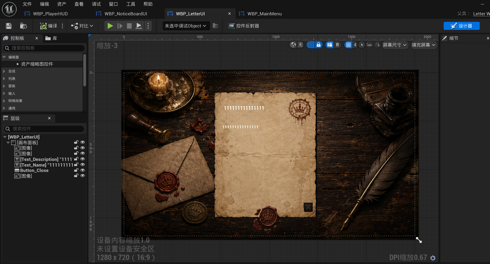

# 信件阅读与可读文本线索记录

更新日期：2026-09-18（Asia/Shanghai）。

本文件记录 `WBP_LetterUI` 的早期阅读原型，以及“线索是否出现在信件以外的文本中、如何表现”的未决范围。它描述当前功能意图和源码现状，不是最终 UI 方案，也不批准修改信件 Widget、文本 DataAsset 或线索系统。

## 当前原型证据

- 来源：用户提供的 Unreal Editor `WBP_LetterUI` 截图。
- 当前画面表达的是在桌面背景上打开一封信：信纸、标题/发件人区域、正文、信封/印章装饰和关闭按钮。
- `111111` 等内容是占位文本；背景、排版、印章、羽毛笔和按钮的尺寸、材质、字体、动画均属于早期原型。
- 用户当前确认的核心功能是“打开并阅读信件”；阅读后的线索收集范围和表现形式尚未确认。

## 当前阅读功能边界

### 设计意图

信件 UI 当前首先承担可读文本的展示和关闭，不自动承担委托接取、派遣准备或推论组合。信件可能是人物关系、背景信息、委托后果或调查入口，但具体文本作用应由 [TEXT_INDEX.md](../story/TEXT_INDEX.md) 和 Story Bible 分别记录。

### 当前代码现状

- `ULetterWidgetBase` 将 `ULetterDefinition` 的标题和正文显示到 `Text_Name`、`Text_Description`，关闭按钮结束阅读。
- 打开信件时进入 UI 输入模式并显示鼠标；从笔记等返回 Widget 时恢复 Game and UI，否则恢复 Game Only。
- 由邮箱直接送达的信件，关闭成功后才调用 `AMailbox::CompleteLetterReading`，收进玩家物品并提交 `LetterOpened` 故事信号；阅读不能重复结算。
- `ULetterDefinition` 的 `FLetterContentSegment` 已有 `bIsClue`、正式 `Clue` 引用、旧 `ClueID` 回退、`WritingText` 和 `WritingSectionID`，并可被内容目录扫描。
- 但 `ULetterWidgetBase::BuildLetterBody` 当前只把各段 `Text` 拼成普通段落；它没有在信件 UI 中把线索段渲染为可点击的 `UClueRichTextBlock`，也没有在关闭信件时自动按段收集线索。
- 旧的 `FReadableDocumentRow` 路径可以把带 `ClueID` 的段落生成 `<clue id="...">...</>` 富文本标记，`UClueRichTextBlock` 再通过点击收集；这说明“可读文本中出现线索”已有一条历史/兼容实现，但不代表它已经覆盖正式信件 UI 或最终设计。

## 线索来源范围：当前只确认到这里

项目总设计已经允许线索来自：

- 信件、公告、书籍和其他正式可读物；
- 环境观察、物件和场景文本；
- NPC 对话；
- 委托返回报告以及其他叙事结果。

这表示“线索不只在委托里”是可行的设计方向，但还没有确定每一种文本都必须包含线索，也没有确定统一的视觉表现。委托正文、信件正文、书页、环境文字、对话和报告可以各自采用不同的发现方式，不能仅因数据结构支持 `ClueID` 就自动给所有文字加红色标记或下划线。

## 待确认的表现方案

以下是需要在可玩文本切片中比较的候选，不是当前需求：

1. **阅读时直接点击文本片段**：玩家在原文中主动确认一段值得注意的信息；优点是参与感强，风险是漏点和“像素搜寻”。
2. **阅读完成后确认关键事实**：玩家先完整阅读，再在信件/笔记中确认获得哪些线索；优点是可理解，风险是削弱发现感。
3. **来源文本只给自然强调，线索进入笔记**：通过措辞、排版或旁观者提示引导注意，但不直接标出答案；优点是保持思考，风险是提示不够时玩家会迷失。
4. **不同来源使用不同表现**：信件偏向段落确认，环境偏向观察反馈，对话偏向选择或回应，报告偏向听取后入账；优点是贴合语境，风险是规则较难统一。

实际采用前至少要回答：

- 玩家怎样知道一段文字“值得注意”，又不会看到所有答案；
- 线索是点击、读完、选择、对话回应还是系统事件后获得；
- 漏掉一段文字是否会导致无声死路，是否有回看、追问或低信息结果；
- 已收集线索在原文中怎样显示，是否能再次点击或只保留状态；
- 来源、日期、关联委托/人物如何进入 `FCollectedClueRecord`；
- 可读文本是否允许同一段同时承担背景气氛和线索功能。

## 明确不包含

- 不在本轮重做 `WBP_LetterUI`、`ULetterWidgetBase`、`UClueRichTextBlock` 或笔记页面。
- 不在本轮决定所有文本的线索覆盖率、点击规则、自动收集规则或统一视觉标记。
- 不在本轮把现有 `FLetterContentSegment` 或旧 `FReadableTextSegment` 字段扩展成新的正式数据合同。
- 不在本轮编写或录入正式信件正文、线索文本或故事真相。
- 不把当前已有的旧可读文本富文本标记实现误报为信件 UI 已完成功能。

## 后续重新评估与退出条件

当至少有一封信件、一段环境文字、一段对话和一份委托报告能够连续体验时，再比较不同来源的线索发现方式，并为每种来源确定：触发时机、玩家反馈、回看方式、来源记录和漏读后的可继续路径。用户确认交互合同后，才建立实现子任务并修改 Widget、数据或正式文本。

2026-10-23表现方向确认：2026-10-23已确认：对话来源的信息随玩家实际听到的内容被动收集；可阅读文本来源的信息由玩家点击指定文本内容主动收集。两类都不以真假或可信程度为收集门槛；获得线索不代表认可其判断，线索匹配仍是建立联系/形成推论。未触达的对话内容不能提前发放。同一线索重复获得不重复授予。此为设计确认，不代表所有正式文本入口已实现；报告回看中的文本与已听取信息如何对应仍需明确。 上述候选中的点击指定文本片段方向已获确认，具体高亮、命中、已收集样式仍待设计。历史代码边界不因设计确认而升级。
