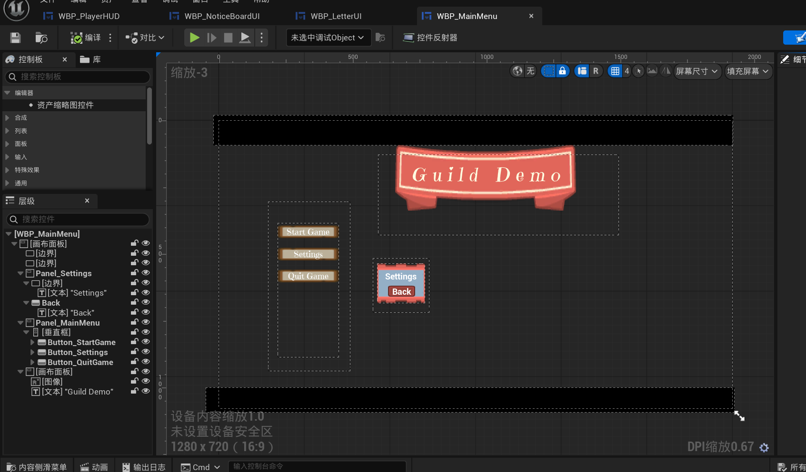

# 主菜单与对应地图早期原型记录

更新日期：2026-09-18（Asia/Shanghai）。

本文件记录主菜单和对应菜单地图的早期设计证据。用户已明确：它与当前 Demo 核心玩法关系不大，后续很晚才修改。因此这里仅保存历史原型、当前资产位置和未来重新评估边界，不把它当作玩法需求或当前 UI 基线。

## 原型截图

- 来源：用户提供的 Unreal Editor `WBP_MainMenu` 编辑器截图。
- 截图可见标题 `Guild Demo`、`Start Game`、`Settings`、`Quit Game`，以及设置面板中的 `Back`。
- 画面中的标题、按钮文字、布局、留白和红色/金色装饰都属于很早期的占位设计；不代表最终项目名称、菜单层级或美术方向。
- 本轮没有收到对应地图的截图，只记录项目中现有的菜单地图资产，不对地图内容作视觉判断。

## 当前资产关联

- 菜单 Widget：`Content/BluePrints/Widget/WBP_MainMenu.uasset`。
- 菜单地图：`Content/Maps/L_MainMenu.umap`，对象路径为 `/Game/Maps/L_MainMenu.L_MainMenu`。
- 菜单运行环境还存在 `Content/BluePrints/HUD/BP_MainMenuPlayerController.uasset` 和 `Content/BluePrints/GameMods/BP_MainMenuGameMode.uasset`。
- `Config/DefaultEngine.ini` 当前将 `L_MainMenu` 设为 `GameDefaultMap` 和 `EditorStartupMap`；这是当前工程入口配置，不等于菜单设计已经确定。
- 当前工作区状态中没有把 `L_MainMenu.umap` 列为本轮修改目标；本轮不保存、不迁移、不重做这些资产。

## 设计状态

| 内容 | 当前口径 |
|---|---|
| 主菜单存在 | 工程入口资产已存在，属于实现现状 |
| 菜单按钮 | 当前截图展示开始、设置、退出和返回的早期意图 |
| 项目标题 | `Guild Demo` 是截图中的旧/占位标题，不是正式名称 |
| 菜单地图 | 与主菜单关联的现有 `L_MainMenu` 资产；地图视觉和用途未在本轮确认 |
| 与核心玩法关系 | 暂不纳入委托、线索、派遣、撰写或七日循环的设计验收 |
| 后续处理 | 等核心玩法、项目名称和整体美术方向稳定后再统一重做 |

## 明确不包含

- 不在本轮修改主菜单 Widget、按钮行为、菜单地图、GameMode、PlayerController 或配置。
- 不根据截图确定最终项目名称、菜单风格、按钮顺序、存档/设置功能或过场流程。
- 不把主菜单原型纳入 `DEMO-DAY-001`、`DEMO-COM-001`、`DEMO-CLUE-001` 等核心玩法完成条件。
- 不把现有 `L_MainMenu` 误认为正式剧情地图、玩法地图或最终发布场景。

## 后续重新评估时机

在核心玩法和整体视觉方向稳定后，再集中处理：菜单是否需要承载存档/继续游戏、设置项、退出确认、标题与世界观关系，以及菜单地图是否需要展示可交互的背景。届时应先确定菜单流程和地图用途，再建立独立实现与人工验收范围；当前截图只作为历史参考。

