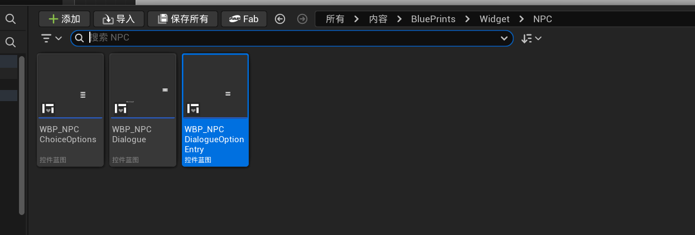

# NPC 对话、选项与旧 ChoiceOptions 原型记录

更新：2026-09-19（Asia/Shanghai）  
状态：结构与历史原型已记录；视觉、剧本和具体交互仍未定稿。

## 截图证据

截图来自 `Content/BluePrints/Widget/NPC/`，显示三个相关 Widget：

| 资产 | 当前判断 | 职责 |
|---|---|---|
| `WBP_NPCChoiceOptions` | 用户记忆为“好像已舍弃不用”；保留为待核对的旧原型，不能据此直接删除 | 早期选项容器，当前不作为确认的运行入口 |
| `WBP_NPCDialogue` | 当前配置的对话主界面 | 显示说话者、台词、选项列表、继续与关闭控制 |
| `WBP_NPCDialogueOptionEntry` | 当前主界面的单个选项条目 | 显示一个选项并将点击转交给对话系统 |

## 现有实现证据

- `Config/DefaultGame.ini` 当前把 `DialogueWidgetClass` 配置为 `WBP_NPCDialogue`，因此主对话入口指向第二个 Widget。
- `UDialogueScreenWidget` 要求主界面绑定 `Text_SpeakerName`、`Text_Dialogue`、`List_Options` 和 `Panel_Continue`；可选绑定继续/关闭按钮。它可显示普通台词、NPC 交互菜单和正式对话选择。
- `UDialogueOptionEntryWidget` 是 `List_Options` 的单个条目，绑定 `Button_Option` 与 `Text_Option`，点击后调用当前 ViewModel 的选择动作。
- 当前代码文本搜索没有发现 `WBP_NPCChoiceOptions` 被 Config 或 C++ 直接引用；但 `.uasset` 的蓝图级引用不能只凭文本搜索排除。因此它只能标为“疑似弃用/待引用审计”，不能标为安全可删。

对话内容本身由完整会话、节点、选项和条件的 `UDialogueDefinition` 管理；NPC 组件持有 Story/Daily/Scene 对话树或交互集合的标识。UI 负责展示和输入，不决定角色知道什么、选项条件或选择后果。

## 不要误报为已确认的内容

- 截图只证明三个 Widget 资产存在及当前命名关系，不证明它们的美术、排版、动效或交互体验已通过验收。
- `WBP_NPCChoiceOptions` 的“可能不用”不是删除授权，也不是已完成的资产迁移结论。
- 当前存在普通台词、交互菜单和正式对话选择三种显示入口，不代表最终所有 NPC 对话都必须有分支、必须阻塞玩法或必须使用同一种 UI。
- 没有正式 NPC 台词、选项文案或剧情揭示在本轮确认；这些以后进入 Story Bible 与 Text Index，再经单独授权录入正式资产。

## 后续需要确认

1. 是否对 `WBP_NPCChoiceOptions` 做只读引用审计，并在确认无引用后再决定保留、归档或删除？
2. NPC 对话是否需要区分闲聊、剧情会话、派遣前咨询、返回报告等表现与输入规则？
3. 选项是否显示前置线索、风险、已锁定原因或后果提示？这需要避免泄露剧情真相。
4. 对话是否可随时关闭、哪些对话/教程应暂时锁定其它玩法、关闭后如何恢复场景输入？
5. 主界面与单个选项条目的视觉重做应何时纳入玩家 HUD/整体 UI 重设计，而不是孤立优化？

## 本轮范围

- 已做：保存截图、记录三个 Widget 的当前职责、把旧 ChoiceOptions 标为待确认的历史原型、更新流程入口和进度矩阵。
- 未做：删除/迁移资产、修改 Widget、代码、Config、DataAsset、正式文本、NPC 行为或输入锁定。
- 自动化/人工验收：未运行、未进行；本轮仅作设计与资产状态归档。

## 相关位置

- `Content/BluePrints/Widget/NPC/WBP_NPCChoiceOptions.uasset`
- `Content/BluePrints/Widget/NPC/WBP_NPCDialogue.uasset`
- `Content/BluePrints/Widget/NPC/WBP_NPCDialogueOptionEntry.uasset`
- `Source/Dispatch/Public/Widget/DialogueScreenWidget.h`
- `Source/Dispatch/Public/Widget/DialogueOptionEntryWidget.h`
- `Source/Dispatch/Public/Component/NPCDialogueComponent.h`
- `Config/DefaultGame.ini`
