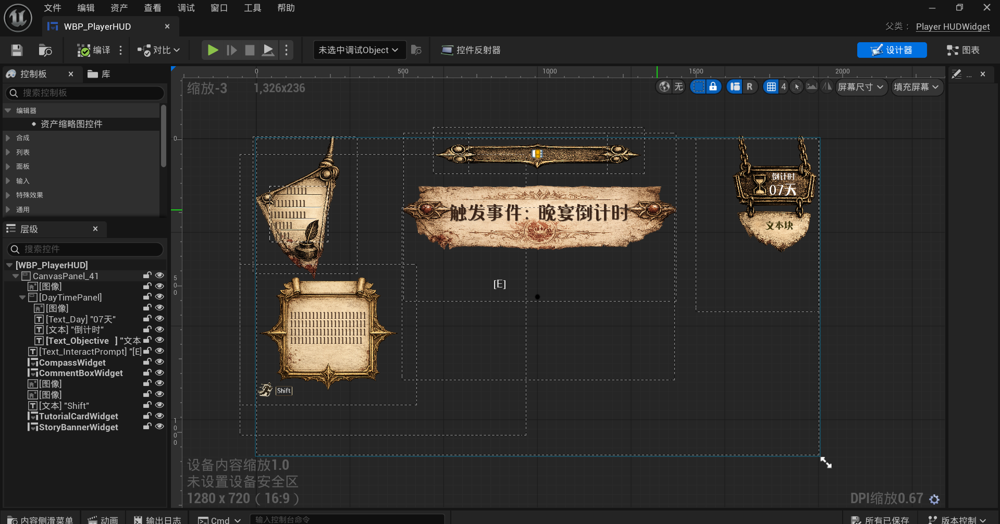
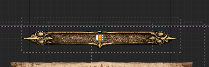
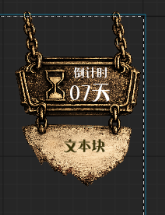
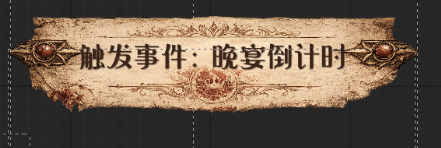
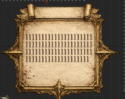

# 玩家主界面设计记录

更新日期：2026-09-18（Asia/Shanghai）。

本文件保存玩家主 HUD 的视觉原型、已经确认的设计意图和仍待体验验证的部分。它描述“想要呈现什么”，不以当前 Widget、C++ 名称或临时实现反推最终需求。

## 当前整体设计状态

- 当前玩家 HUD 基本都需要在后续重新设计，包括罗盘；现有截图是原型和实现历史证据，不是最终视觉目标。
- 已经确认的功能意图可以继续作为重新设计的输入，例如旁白承担轻引导与气氛、罗盘只展示一个当前追踪目标；但功能存在不等于当前表现形式必须保留。
- 现有布局位置、尺寸、框体、材质、颜色、字体、图标、动画、显隐方式和信息层级均不因截图而锁定；至少“当前目标指引”这一组件是否长期存在，也需要由真实流程和试玩重新判断。因此 HUD 重做不只等于换皮。
- 重新设计应等基础玩法能够实际运行后，结合真实阅读距离、遮挡、操作频率、信息优先级和整体美术风格一起判断，而不是逐块美化后直接拼回当前布局。
- 在整体重新设计获得单独授权前，当前任务只继续恢复各组件的功能目的、交互需求和已有实现，不修改 Widget 或 UI 素材。

## 原型证据



- 来源：用户提供的 `WBP_PlayerHUD` 编辑器截图。
- 本轮确认范围：左上角旁白/注释框的功能与初衷。
- 图中其他 HUD 元素只证明当时存在整体布局原型，不因本记录自动成为已确认设计，也不作为其完成或人工验收证据。
- 截图是视觉参考；当前 Blueprint 和代码是实现现状。二者都不能单独替代用户的设计意图。

## 左上角旁白/注释系统

### 当前确认的功能与初衷

- 它不是任务目标、数值、状态等常驻 HUD 信息展示。
- 它在合适的情境短暂出现一句话，承担教学、轻引导、气氛补充和观察性反馈。
- 示例语境：玩家第一次来到委托所时，可以出现“这是个破旧的地方，看看有什么要注意的”一类句子；措辞应像记录员脑中掠过的一句话或旁观者留下的注释，不像教程管理员发号施令。
- 语感参考受到《极乐迪斯科》背景式内心声音启发，但当前目标没有那么强的第三人称叙事感，也不照搬其系统结构。
- 它可以带来“似乎有人在看着这份记录”的轻微感觉，但目前不确认这是否对应真实角色、玩家内心或外部叙述者。
- 它希望减轻玩家独自探索时的孤独感，同时削弱“世界完全以玩家为中心”的感觉。这与 NPC 设计原则一致：玩家是世界的一部分，但不是唯一中心；NPC 也不是依附玩家存在的挂件。

### 当前不确定、不得擅自补完

- 旁白身份、来源和它是否最终成为剧情揭示，尚未确定。
- 是否在剧情完善后解锁或解释旁白来源，只是保留方向，不是当前剧情事实或实施要求。
- 具体语气词典、出现频率、触发清单、持续时间、声音设计和最终外观尚未确认。
- 当前视觉设计尚未达到用户满意状态，并属于玩家 HUD 后续整体重新设计范围；不能把截图中的尺寸、边框、位置和动效标成最终稿。
- 该功能是附属表现，不是完整游戏流程的关键前置；当前不因记录它而改变主要实施顺序。

### 后续重新评估时机

当基础玩法能够实际运行、剧情声音开始稳定，或可玩测试需要判断教学打断感、探索孤独感与玩家中心感时，再重新评估本系统。届时至少检查：

1. 玩家是否把它误认成普通系统教程或任务提示；
2. 它是否过度打断探索、替玩家下结论，或抢走 NPC 的陪伴作用；
3. 它是否真正提供了轻引导和气氛，而不是增加无意义文字；
4. 是否有足够剧情依据决定旁白身份，还是继续保持模糊更合适；
5. 当前左上角视觉、打字节奏、声音和停留方式是否适合真实游玩。

## 当前实现映射（不是完成声明）

- 原型 Widget：`/Game/BluePrints/Widget/Menu/WBP_PlayerHUD`。
- 截图层级中可见 `CommentBoxWidget`；源码中现有 `UGuideCommentWidget` 负责展示和打字机表现，`UGuideCommentSystemComponent` 负责条件、播放策略、队列与触发。
- 现有技术名称 `GuideComment` 不代表产品语气已经定为“教程引导”。未来实现和文本必须以上述功能意图为准。
- 本次只增加文档和截图，没有修改 Blueprint、C++、DataAsset、配置或游戏内文本。

## 上方中央罗盘与任务方向标记



### 当前确认的功能与状态

- 罗盘位于玩家主界面上方中央，用于提供朝向参照。
- 当任务具有需要指示的位置时，罗盘上可以显示感叹号形式的方向标记。
- 罗盘同时只显示一个当前追踪目标。游戏可以存在多个任务，但它们不会在罗盘上并列显示多个感叹号；切换追踪目标时替换当前标记。
- 用户判断这部分功能“应该已经完成差不多”，但当前表现形式仍不理想；罗盘明确属于玩家 HUD 后续整体重新设计范围。
- 因此当前口径是：功能实现已有较完整基础；视觉设计和游戏内体验没有通过最终人工验收，不能写成整体完成。

### 当前实现证据（不是最终设计）

- `UCompassWidget` 会根据玩家视角计算东、南、西、北在横向罗盘中的位置和可见性。
- 当前剧情目标提供单个 `ObjectiveMarkerTarget`；设置新目标会替换旧目标，清除目标会隐藏标记。导航系统解析目标位置后，罗盘计算并显示该目标的方向。目标位于显示角度之外时，标记会限制在左右边缘；出现和消失支持淡入淡出。
- Widget 可以绑定设计者提供的 `Image_ObjectiveMarker`。截图中的感叹号属于当前视觉原型；缺少绑定时，源码还有一个金色菱形图标作为兼容回退，这不代表最终美术要求。
- 现有源码测试覆盖角度映射、越过 180 度、目标标记边缘限制和 Widget 绑定合同；本次记录没有重新运行测试，也没有进行 PIE 或正式地图人工验收。

### 当前未决定、后续需要优化

- 感叹号与罗盘底框在颜色、尺寸、层级、动效和视觉融合上的最终表现尚未决定。
- 是否显示距离、任务名称、上下高度、屏幕外提示或其他信息尚未决定，不能因常见罗盘设计而自动加入。
- 多目标并列不属于当前设计；以后只有出现明确玩法需要时才重新讨论，不能预先扩展。
- 后续修改应先在真实游玩中观察：标记是否容易找到、是否遮挡、是否过度抢眼、转向时是否抖动，以及玩家能否理解它指向的是任务位置而不是交互按钮。

### 本轮边界

- 本轮只保存原型与当前设计判断，不修改罗盘 Widget、图片、动画、导航、剧情目标或测试。
- “功能差不多”只描述用户对当前成熟度的判断，不等于代码已在当前工作区重验，也不等于视觉人工验收通过。

## 右侧剩余天数与当前目标指引



### 剩余天数

- 上方沙漏区域用于显示七日流程还剩多少天。当前实现显示的是包含今天在内的剩余天数，不是当前日编号：第 1 天显示 `07`，第 7 天显示 `01`。
- 当前代码允许剧情流程显式显示或隐藏数字，并在开始新一天时更新；原型中的“倒计时”与两位数字是当前表现，不是最终视觉批准。
- 用户本轮没有确认该组件的最终外观、出现时机或是否必须始终可见；这些仍属于 HUD 整体重新设计范围。

### 当前目标指引

- 下方区域的原始目的，是在玩家不知道接下来能做什么时提供一个大概方向，降低迷失和无目标感。
- 该功能是否应该长期存在仍有疑问。只有实际游戏流程和试玩显示玩家确实经常不知道该做什么，才有充分理由保留或强化；不能因为当前原型和代码已经存在，就把它自动视为最终需求。
- 当前实现保存一条当前目标文字；设置非空文字时显示，清除或空文字时隐藏，并带有从右侧进入和淡入的表现基础。
- 它不应提前被定义成持续命令玩家的任务清单。未来若保留，具体是常驻、情境出现、玩家主动查询还是其他形式，均待可玩流程验证后决定。

### 重新评估触发条件

在基础探索、对话、委托和日终流程能够实际游玩后观察：

1. 玩家能否从场景、NPC、委托所和自然反馈理解有哪些事可做；
2. 玩家迷失是因为流程表达不清，还是确实需要 HUD 目标提示；
3. 指引是否把自由探索误导成线性任务清单，削弱玩家自行判断；
4. 剩余天数是否制造合适的七日压力，还是造成不必要焦虑或误读；
5. 如果需要帮助，是否应先修正世界反馈，再决定保留多少 HUD 文字。

### 当前实现证据与本轮边界

- `UPlayerHUDWidget` 从 `DayFlowManager` 读取 `CurrentDay`/`MaxDays`，计算 `MaxDays - CurrentDay + 1`；`StoryDirector` 保存并转发当前目标文字及倒计时显隐状态。
- 现有测试源码覆盖第 1 天 `07`、第 7 天 `01`、故事开始前隐藏，以及当前目标设置/清除；本轮没有重新运行 Unreal 测试，也没有进行真实流程人工验收。
- 本轮只保存原型和设计判断，不修改 Widget、文字、动画、StoryDirector、DayFlow、代码或资产。

## 中央事件横幅与教程卡片

### 事件触发横幅



- 横幅用于在重要事件或阶段变化发生时，向玩家短暂提示“发生了什么”，例如原型中的“触发事件：晚宴倒计时”。
- 它属于叙事事件提示，不是当前任务目标、教程步骤或永久状态栏。
- 当前实现拥有独立的 Story Banner 通道、队列、可选声音、显示时长和淡入淡出；默认约 4 秒后开始消失。
- 横幅的文案格式、优先级、出现频率、是否允许跳过及最终视觉仍未确认，也属于 HUD 整体重新设计范围。

### 教程卡片



- 教程卡片用于解释操作或玩法。用户希望后续不再仅靠弹出后等待一段时间自动消失，而要与玩家的理解或操作产生实际联系。
- 已确认的流程语义是：教程未完成之前，与该教程对应的功能或剧情不能继续；玩家点击确认或完成教程要求的对应动作后，教程才算完成并解除对应锁定。点击和动作如何组合仍需细化。
- 当前实现只有 Tutorial 显示通道、FIFO 队列、定时保持和淡入淡出；默认约 6 秒后自动消失。
- StateTree 的 `bWaitForCompletion` 当前只是等待该定时显示请求结束，不会等待玩家输入，也不会验证玩家是否完成移动、交互、打开界面等对应动作。
- 当前没有独立的教程确认、动作达成、已学习持久状态或重看教程合同，因此不能把交互式教程误报为已经实现。

### 已确认的教程门槛

```text
触发教程
  ↓
对应功能/剧情保持锁定
  ↓
玩家点击确认或完成要求动作
  ↓
教程完成并记录完成结果
  ↓
解除对应锁定，继续功能或剧情
```

- 这里的锁定范围是“该教程对应的功能或剧情”，不是默认冻结整个游戏；具体边界要由每个教程条目声明。
- 事件横幅不继承这个门槛。它仍是非阻塞的短暂事件通知，不能因为与教程共用显示基础而阻止剧情继续。

### 后续教程内容候选（尚未定稿）

用户举出的候选方向包括：

- 打开某个界面或功能；
- 学会如何派遣；
- 学会如何组合线索；
- 其他需要玩家亲自完成操作才能理解的玩法。

这些只是未来教程设计的例子，不是当前已确认的教程清单。因为对应玩法和完整流程尚未完成，现在不能提前编写正式教程文本、锁定具体输入或决定每条教程的剧情位置。应先把玩法做出可体验的最小流程，再为每个教程定义触发、锁定对象、完成动作和解除锁定结果。

### 后续设计需要回答

1. 点击教程卡片是否只代表“我读过了”，还是可以直接代替教程动作完成；
2. 对移动、交互、打开笔记等教程，完成对应动作后是否自动关闭卡片；
3. 每个教程具体锁定哪一项功能或剧情，以及是否允许玩家先处理其他不相关内容；
4. 卡片是否允许最小化、重新打开或从帮助页面重看；
5. 教程完成状态是仅本次流程、每个存档一次，还是玩家账户级设置；
6. 多条教程同时触发时怎样排队、合并或避免遮挡。

### 重新评估与本轮边界

- 在第一天教程流程和真实输入动作稳定后，再为不同教程类型定义“展示、确认、动作验证、完成和重看”合同。
- 教程候选应优先从实际玩法中产生：打开界面、派遣、线索组合等只有在对应玩法可操作后，才进入正式教程设计。
- 事件横幅可以继续作为短暂通知候选；教程卡片需要另行设计交互完成语义，二者不能因共用显示基类而被当成同一种消息。
- 本轮只保存两张原型和功能判断，不修改 Widget、计时器、StateTree、输入、存档、代码、资产或正式教程文本。

## 后续 UI 记录规则

以后用户说“继续看主界面”“优化旁白框”“修改罗盘/任务标记”“修改倒计时/当前目标”“修改事件提示/教程”“修改 HUD”或提供新的 UI 原型时，先读本文件并逐个组件确认：原型证据、功能目的、交互状态、数据来源、待验证问题和明确不包含范围。未经确认，不从一张整体截图推断其他组件已经定稿。
