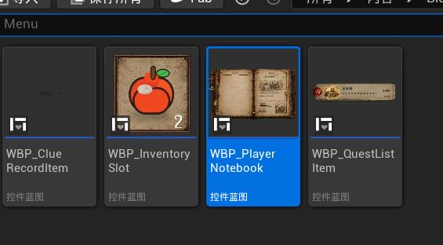
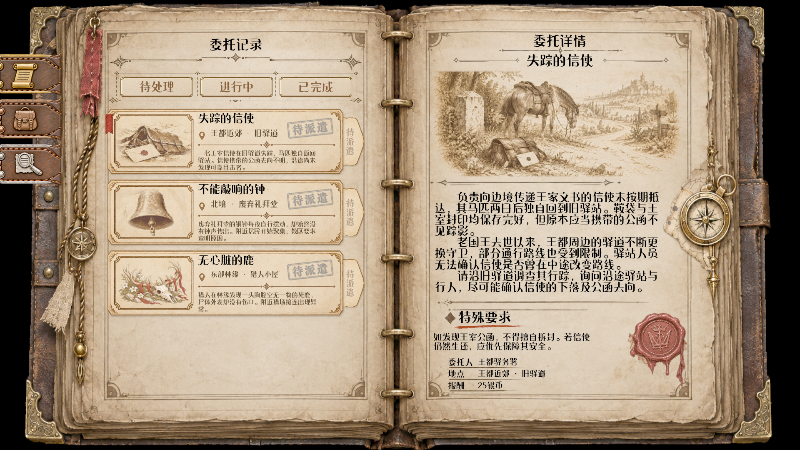
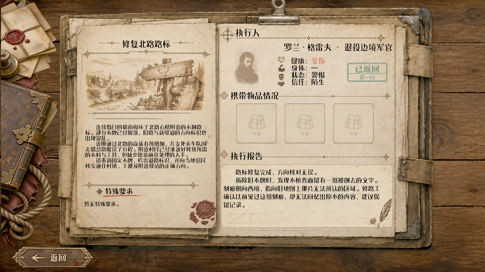
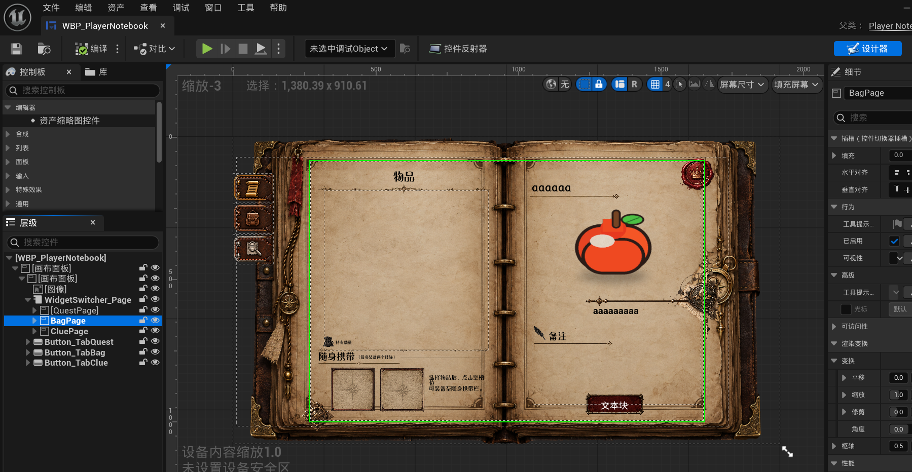
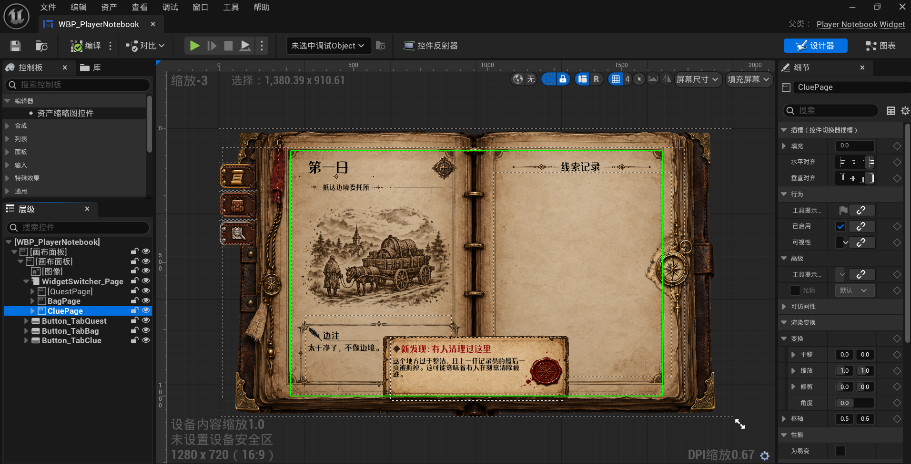

# 玩家记录本：委托、物品与线索页原型

> **玩法口径（2026-10-28）**：记录本当前概念职责是查看已经获得的信息、追踪委托状态、查看 NPC 报告、整理线索和组合新线索。记录本不承担首次报告结算，也不直接代替撰写系统对结局的影响。具体信息密度和交互方式待 Demo 验证。

更新：2026-09-20（Asia/Shanghai）  
状态：下方按日期保留历史原型和实施过程；当前确认见本页专节，实施与验收进度以矩阵及CURRENT为准，不能把历史“未做”当成当前全局结论。

## 卷宗见闻当前确认（2026-10-28恢复核对）

当前布局参考（2026-10-28恢复核对；可继续迭代）：[原三条图文见闻与物品样式](../evidence/2026-10-28-context-audit/Reference_01_InProgress_Final.png)。已从Saved原路径等内容留存，来源、哈希及使用边界见[证据清单](../evidence/2026-10-28-context-audit/README.md)。用途为图文行结构、对齐和分隔线比较，文件名Final不表示永久定稿。执行者修改前须实际打开图片。图中的旧NPC名称/职业、身体“正常”、活动状态和示例物品只是旧样例；这些内容不覆盖最新的姓名只显示姓名、[四字段定义](../FOUNDATION_DATA_DESIGN.md#npc-four-fields-current)及用户实际文本。

以下是已确认设计目标及历史布局参考，不表示新版本已经人工验收。用户2026-10-28最新要求恢复原三条同屏样式，明确允许为此缩小字号或删减正文。当前选择保留原字号与图文行，用两行摘要恢复密度；原稿另存，不把旧“全文不得删减”继续当成限制。图片仍暂不填，保留左图栏。新工作区及验证见矩阵。

- 每条左侧插图，右侧日期/来源和正文；文字在图文区域内垂直居中，支持淡黄关键词高亮。三条信息仅中间两条分隔线，末条无底线。
- 最终分隔线两端尖角对齐插图左缘与正文右缘；覆盖此前“缩短五分之一”的试版。沿用用户保存的页面区域与行间距，不因填数据自动改成通栏布局。
- 三条摘要同屏是本轮明确目标；不靠强行隐藏滚动条掩盖溢出。内容放得下隐藏滚动条/箭头，其他长输入实际溢出仍可滚动。
- 旧作者布局证据：行宽660、图框148×82、来源15/正文17、图文间隔14、上下padding4；这些数字是当时实现记录，后续若用户在UMG修改，以最新已保存布局及确认图核对，不能重跑旧作者命令覆盖。
- 本轮维拉三条见闻日期/来源保持；经用户允许压缩正文为下列预览摘要，三张图仍为空。原始长文见[原稿留存](../evidence/2026-10-28-context-audit/vera-observations-original.md)，可恢复，不作为另一份现行正文。

| 来源 | 当前预览摘要（换行分两段） |
|---|---|
| 第2日 · 边境驿站 | 商队载粮袋、药材和日用品离站。 值夜人称多了一名来历不明的临时护卫。 |
| 第1日 · 岔路口车辙 | 两组车辙中，一组转向旧采石道。 附近散落麻袋纤维与破裂木箍，似曾临时停靠。 |
| 第1日 · 村镇传闻 | 补给村商人称，护卫把货看得比命紧。 商队是否进村，目击者说法不一。 |
- 确认来源：原对话 `01a133fa-a73e-7ac0-a629-6e36076fa45d`；三条两线回合 `01a16bfe-6923-7791-8612-18a648209bb8`，舒展/居中 `01a16c0a-0467-7f43-be53-d6d43d242154`，溢出显隐 `01a16c12-a728-7860-8c8d-9ad6e47803ba`，线端最终修正 `01a16c7c-6b23-77b3-9a21-c2f4057ff4ce`。详见[原对话核对](../handoffs/2026-10-28-original-thread-context-audit.md)和[行控件阶段交接](../handoffs/2026-10-24-observation-row-visual.md)。

本对话早前通栏折叠方案已否决且源码撤回；本轮已重新编译Development。早前2/2仅证明被否决方案；当前摘要三条同屏需本轮渲染证据，人工体验仍待用户复看。

本轮已取得[三条摘要同屏实际图](../evidence/2026-10-28-verified-notebook/Dossier_VeraObservations_Compact.png)及[11项通过记录](../evidence/2026-10-28-verified-notebook/README.md)。第三条完整可见，无需缩字号；只证明当前摘要/空图输入，用户人工验收仍待复看。

## 当前实现核对（2026-10-28）

正式实例读取、NPC运行信息优先及事件刷新已存在，Association五项本轮通过；已提交结果只读回看通过ReviewedReport测试。后续日期段落中已过期的实施状态在原位置作标记。首次NPC报告完整流程仍未在本轮验收。来源见矩阵及本轮交接。

## 总体边界

`WBP_PlayerNotebook` 是同一本记录本内的三个不同页面：`QuestPage`、`BagPage` 和 `CluePage`，通过 `WidgetSwitcher_Page` 和三个侧边标签切换。它不是一个单纯背包：委托页服务于已知委托与状态，物品页服务于持有物及可读物，线索页服务于已收集线索、比较和推论。三页视觉可统一，但信息职责和玩家动作不能互相替代。

用户指出这三个原型“或多或少都有问题等待解决”。本页不擅自归因，也不把截图中的占位文字、示例图或当前布局视为最终需求。

## 三个独立条目 Widget

用户补充：围绕 `WBP_PlayerNotebook` 的三个独立 UI 格，从左到右分别是：

| 页面 | 独立 Widget | 职责 |
|---|---|---|
| 线索页 | `WBP_ClueRecordItem` | 单条已收集线索的显示与选择；由记录本传入线索记录、定义和当前是否可交互 |
| 物品页 | `WBP_InventorySlot` | 单个物品格；显示物品或空格，并把选中事件交回记录本 |
| 委托页 | `WBP_QuestListItem` | 单条委托列表项；显示标题、摘要、地点、状态和选中态，并把点击交回记录本 |

截图中央的 `WBP_PlayerNotebook` 是三者的页面容器，不属于这三个单项 Widget。苹果图标和右下角的数字只证明物品格可带图标/数量表现；不能据此确认最终的堆叠、数量规则、尺寸或视觉风格。

三个条目要保持各自数据职责：线索条目不能变成委托进度，物品格不能默认承担线索推论，委托条目也不应取代派遣准备或报告。后续若改视觉或交互，应先确定对应页面的问题，再修改其所属单项 Widget，而不是把所有逻辑挪进记录本父 Widget。

## 委托页：QuestPage

上述图片是当前隔离预览证据。旧版“列表为空、右侧仍显示样例内容”的截图属于历史编辑器原型，不再作为当前布局依据。

【历史状态，已由上方当前实现核对替代】当时 C++ 可重建旧委托列表、选择单项，并展示标题、描述、Meta 和两张详情图。2026-10-13 已给真实 Widget 加入三个阶段按钮；原版共用用户新版 2171×724 无字图集 `T_NotebookFilter_SharedBlank_States_v2`，三列是默认、悬浮、按下，字由 UE TextBlock 绘制。2026-10-15 用户在装饰条左侧放入单框后，仅“待处理”按钮改为透明点击区覆盖该框，并追加可透纸纹的暖棕渐隐内底作视觉试验；默认、悬浮、按下逐级加深，“进行中/已完成”仍用共享图集，尚未确认迁移。点击松开后不常驻红色。2026-10-14 按钮已按传入 `FQuestInfo` 的记录本展示阶段筛选左页；未接取记录排除，切换清空旧详情。当时正式实例实时映射未接入；当前已存在并取得局部测试证据，见上方实现核对。

2026-10-13 用户确认：左页仅列已接取委托；顶部“待处理/进行中/已完成”可点击筛选，同一委托不可重复派遣。当时条目状态标签只展示、不可点击（该交互要求后被侧签打开只读卷宗替代，待处理入口锁定；见后续记录及总设计）。NPC 返回后，玩家须先找到对应 NPC 对话听取报告；记录本此时仅显示状态，不直接结算。完成后的报告回看属于后续独立阶段，不能由本次按钮小步推定已接线。

## 物品页：BagPage

截图意图是左页物品列表/随身携带区域，右页显示选中物品的名称、图标、描述、备注及一个行动按钮。`aaaaaa`、苹果图标和“文本块”均是占位内容，不是正式物品、文本或功能结论。

当前实现按固定 16 格、4 列生成物品格；选择物品后显示详情。只有物品关联信件时，当前行动按钮才显示“查看”并打开信件阅读；装备/卸下目前不是已实现玩法。容量、分类、堆叠、用途、委托交付和与线索的关系均需要按真实玩法另行确认。

## 线索页：CluePage

截图显示日期、地点、日记式插图、边注与右页“线索记录”；下方还有“新发现”提示。该截图确认的是表现方向，不确认具体文字、每一天必须有插图，或新发现提示的触发/停留时长。

现有代码已支持按日构建线索页、显示已收集记录、选择两条线索比较并展示成功/失败/推论反馈；已提交或过去日期保持只读。它不证明线索页面的可读性、提示密度、比较操作、失败反馈和推论解释已经通过真实玩家体验验收。

三张线索组合概念图及“已实现功能基础/未实现完整体验”的拆分见 [线索组合与推论 UI](CLUE_INFERENCE_UI.md)。

## 统一待解决问题

1. 三页各自最重要的第一眼信息是什么？侧边标签、书页标题和详情区是否让玩家迅速知道自己所在页面与可做动作？
2. 委托状态筛选、物品操作和线索比较分别如何给出可理解的反馈，而不让玩家误以为三者是同一种“收集清单”？
3. 右页详情在空列表、未选择、已锁定、内容缺失时应显示什么，避免当前样例/占位内容被误解成真实信息？
4. 线索发现提示、每日记录、物品查看与委托更新在何时出现、是否打断玩家、如何回看？
5. 固定书本美术与不同分辨率、DPI、长文本、空状态及滚动内容如何兼容？
6. 记录本三个侧边标签的动画/选中反馈已存在实现历史，但仍需在实际 DPI 下做人工手感验收；不应仅以自动化通过作为视觉完成。

## 本轮范围与后续

- 已做：保留用户删除装饰的 Widget 修改；在左页加三个阶段按钮并统一底图，用 UE 文字标签显示三个阶段。接入默认、悬浮、按下三态及点击阶段索引；点击后按钮恢复默认外观。旧带字纹理保留供回退。
- 已做：对传入记录按顶部三类按钮筛选左页，排除未接取记录；旧 `Accepted/Sealed` 兼容到待处理/已完成，显式 `NotebookStage` 可指定进行中。
- 未做：正式委托实例的实时映射、未派遣/待听报告条目标签、报告对话/结算、正式 DA、存档、背包及线索逻辑。
- 自动化：2026-10-13 Development 构建退出 0；新版图接线后，真实 RHI 的共用纹理、字体/标签、三态裁切、点击、1920×1080 实际渲染及原页签回归 4/4 通过（`Saved/Logs/NotebookFilterBlankV2FinalRHI.log`），实图已复看。
- 人工验收：按钮在原生 PIE 的位置、颜色和点击手感待用户复看；自动验证不代替审美确认。

## 相关实现

- `Content/BluePrints/Widget/Menu/WBP_PlayerNotebook.uasset`
- `Source/Dispatch/Public/Widget/PlayerNotebookWidget.h`
- `Source/Dispatch/Private/Widget/PlayerNotebookWidget.cpp`
- `Source/Dispatch/Public/Widget/QuestListItemWidget.h`
- `Source/Dispatch/Private/Tests/QuestNotebookWidgetTests.cpp`
- `Source/Dispatch/Private/Tests/PlayerNotebookCluePageTests.cpp`
- `Source/Dispatch/Private/Tests/NotebookTabInteractionTests.cpp`
- `Source/Dispatch/Private/Tests/NotebookCommissionFilterTests.cpp`

2026-10-15 单框续试：按用户新参考和明确选择，待处理改为浅纸面默认、红棕细边悬浮、加深按下；用独立内底/细高光三态图集叠于原外框，隐藏上一版棕色内底。另两按钮未迁移。真实 RHI 渲染与列表筛选 2/2 通过，三态图 PaperBevel_ThreeStates.jpg 待人工审美验收。
默认态颜色续调：用户要求新参考暖纸色，仅将第一列浅白内底改为浅金褐，另两状态逐像素不变；WarmDefault.jpg 为最新默认态实图，NotebookWarmDefaultRender.log 1/1 通过。
用户指出改暖版本偏黄且接近悬浮，现默认内底降饱和至米色，并加强悬浮/按下细边；NeutralDefault_ThreeStates.jpg 为最新画刷实图，NotebookNeutralDefaultRender.log 1/1 通过，待人工验收。
用户 2026-10-15 更换透明单框与长饰线后，待处理内底改用项目本地干净纸卡中间 UV 纹理，点击区对齐新框、默认透明、文字 24；最新对照 UserArtBeforeAfter_1400x290.jpg。仅此一格，其他两按钮布局不动；原生审美待复看。

2026-10-16 待处理单框新试验：用户提供一张自带清晰纸纹的完整框，替换 Image_27；旧独立纸纹内底不再引用，现有 Image_CommissionPendingFill 改作框内暖棕半透明遮罩，文字回归透明 Button 并与框对齐。另两按钮不动。真实 RHI 按钮交互/列表/渲染 3/3 与页签绑定 1/1 通过；默认实图 UserParchmentMask_1000x450.png 比目标预览偏浅偏灰，审美未验收。用户要求先只评价默认态，暂不继续调悬浮/按下。

2026-10-16 新素材复试：仅 Image_27 从上一版完整纸纹框切换到 T_NotebookFilter_UserParchment_20261016_v2，遮罩、文字和透明点击区不变；UserParchment_V1_V2_Default.png 左旧右新。新纸纹与亮边更清楚，默认色仍偏浅，审美待用户判断；真实 RHI 按钮交互/列表/渲染 3/3 通过。

2026-10-16 三态素材复试：用户明确三张图顺序为默认/悬浮/按下。默认与当前 v2 PNG 哈希一致，新增两张独立 UI 纹理供待处理 Button 悬浮/按下画刷；运行时相应状态隐藏底层默认框，防双边，文字和遮罩保留。UserParchment_ThreeStates.png 左中右三态实图已复看；筛选组测试 3/3 通过，原生 PIE 手感未验。进行中/已完成未改。

2026-10-16 轻渐变：待处理三态图上叠独立透明暖棕竖向渐变 T_NotebookFilter_SubtleVerticalGradient，上缘轻、下缘略深；UImage z=11 且不可命中，统一透明度 0.22。三张用户原图与另两按钮不动。最终实图 UserParchment_ThreeStates_GradientFinal.png 与筛选组 3/3 自动验证成功；原生 PIE 手感待用户。

2026-10-16 过渡：仅待处理按钮把三张纸纹框改成叠层，悬浮和按下按帧淡入；鼠标移出、松开按同一插值反向渐隐。悬浮速率 5、按下速率 6，点击筛选即时执行。竖向遮罩和另外两颗按钮保持原样。模拟指针的六帧截图与筛选组 3/3 自动验证通过；原生 PIE 的时长和审美仍待用户。

2026-10-16 三按钮统一：进行中、已完成移入顶部余下两格，与待处理共用三张纸纹框、轻微竖向遮罩和相同的移入/移出/按下/松开过渡。顶部饰线 Image_15 的纹理整理为 T_NotebookFilter_HeaderOrnament。引用审计后，两个旧菜单纹理及八个筛选试验纹理连同对应源图共 19 件移出 Content，保留在 Saved/CodexBackups/NotebookFilterDiscarded_20261016_0818。清理后真实 RHI 筛选 3/3、页签 2/2 成功；三按钮截图 ThreePhaseParchment_1920x1080.bmp。原生 PIE 手感、审美仍待人工验收。

2026-10-16 顶部对齐修正：按用户编辑器截图，将进行中/已完成连同命中区、默认/悬浮/按下层和遮罩分别左移 14/28 px，使纸框靠拢线框分格；待处理不动。更新后的 ThreePhaseParchment_1920x1080.bmp 已复看，自动筛选 3/3、页签 2/2 成功；原生编辑器和 PIE 外观待用户复看。

2026-10-16 三槽内缩小居中：三颗框和透明点击区从 201.21×86.454 统一缩为 184×78，围绕各自原中心定位；默认/悬浮/按下层同步，渐变层缩为 172×64 并居中。ThreePhaseParchment_1920x1080.bmp 已复看，三框在各自线框分格内留出间隙；真实 RHI 筛选组 3/3 成功。原生编辑器/PIE 审美及手感待用户确认。

2026-10-17 整体拖动：三颗顶部按钮各自新增 Group_CommissionPending/Active/Completed 父 Canvas，标签为“待处理/进行中/已完成按钮（整体拖动）”。默认/悬浮/按下/渐变/透明点击区和 Button 子文字一起跟随父容器；内部只锁定设计器选取，单独编辑时可在层级面板解锁。原尺寸、位置与运行时交互保留，改层级前后默认截图哈希相同。真实 RHI 移动验证及筛选 3/3、页签 2/2 成功；原生设计器实际拖动待用户验收。

2026-10-17 扁平分类标签：184×78→184×68（高度减约 13%），保留宽度、字号、用户最新横向位置及旧垂直中心；文字居中，渐变内层 172×54。当前分类持续使用既有红棕 Hover 图，离开鼠标后保留，切类后旧类按原速度还原；默认待处理选中。整体拖动保留。真实 RHI 筛选组 3/3、页签 2/2 通过，包含持续选中切换/文字中心/整组移动/原三态缓动；默认和各类选中实图已输出，原生审美待用户确认。

2026-10-17 用户纠正：取消常驻红色选中态，只在悬浮/按下变红，离开平滑回默认；分类索引仍筛选列表。实际需求为默认纸面太白，因此三颗默认框使用轻暖棕乘色 (0.88,0.84,0.78) 压暗调暖，不改源纹理、字体、184×68 或整体拖动。最新默认图 ThreePhaseParchment_1920x1080.bmp、分类点击后默认图 AfterFilterClick_*.bmp；旧 Selected_*.bmp 不再代表当前方案。真实 RHI 筛选/交互/渲染 3/3 通过，原生默认色审美待用户确认。

2026-10-17 字号/字色：探针确认三颗为 24/21/21，同字体；按用户指示仅将待处理 24→21。三颗文字复用原悬浮/按下缓动，从深棕渐变红棕，按下稍深，离开回深棕；无常驻红色。默认暖纸色、184×68、位置和整体拖动保留。NotebookLabelHoverVerify.log 真实 RHI 筛选/交互/渲染 3/3 通过，默认 ThreePhaseParchment_1920x1080.bmp 与悬浮 UserParchment_Hover.bmp 已复看，原生字色审美待用户。

2026-10-18 左页列表参考排版：保留用户已替换的纸卡、侧签和红色选中签；去掉 Button_Quest 正常画刷 0.495466 灰乘色，正常/悬浮均用源图，按下轻压暗；裁源图透明边的 UV，不重绘纹理。行根 SizeBox 616×170（纸卡 568×160、间距10及只读侧签），ScrollBox_QuestList 改左上锚点 (-34,168)、616×520，首屏三条。标题20号黑字/摘要14号深棕均 X=218，对齐源图地点图标和分割线；地点14号 X=248，状态16号在侧签竖排。四字段保持 Title/Location/Summary/Status；摘要修正原负高度并支持两行换行，所有状态签 HitTestInvisible。根据已传入 NotebookStage 显示待派遣/派遣中/已完成；当时正式实例来源及待听报告/报告事务未接线；目前实例映射和只读回看已接，首次NPC报告完整流程仍待验。临时三条输入的渲染、点击/六条滚动和原接口等局部自动 11/11 成功，ThreeCards_1920x1080.bmp 已复看，原生审美待用户确认。顶部分类按钮保留。

2026-10-18 用户优化后柔影：保留最新纸卡568×160、行616×170，以及侧签(528,27.192)/95.520×103.970和状态文字(568,48)、红签的新尺寸。仅新增“纸卡柔影”和“状态签柔影”两组，可调 RenderOpacity；侧签投影在底层，纸卡投影位于侧签之上形成接触暗边，纸面文字保持原色。无阴影实图与修改前哈希相同，最新记录本真实 RHI 6/6 通过；原生审美待验。父 Widget、源图及数据链本步未改，详见当前列表交接。

2026-10-18 外伸装饰裁切/素材归类：滚动视口由(-34,168)/616×520扩为(-50,160)/648×528，设计器预览和运行时条目均左右16内距、首条顶部8内距，补偿偏移后纸卡原位、行616×170及170步距不变；红签负X部分与柔影有显示空间，保留滚动裁切。三纹理经 UE RenameAssets 整理为 /Game/UI/Inventory_UI/QuestPage/QuestList/T_NotebookQuest_Card、T_NotebookQuest_SelectedRibbon、T_NotebookQuest_StatusTab，蓝图/阴影引用已更新、源图保留。最新真实 RHI 记录本6/6通过，选中图已复看，原生设计器/PIE待验收。详见列表交接。

2026-10-18 整卡拿起反馈：沿用现有纹理，将全部图文/侧签/红签与阴影按原Z序放入 Lift_QuestSurface；默认几何不变。悬浮1.018倍、上移2.5，约0.3秒渐入；按下回落1.4%/+2.1Y，松开回悬浮，离开约0.4秒平滑落回。阴影逆变换抵消纸卡移动并略扩散加深，保留在页纸下方；移除按下瞬时灰乘色。点击选择/原详情和扩出装饰显示空间保留，真实Slate交互/渲染6/6通过，默认图哈希不变，原生手感待用户。详见列表交接。

## 2026-10-18 整个J记录本快速预览
用户确认先做快速预览、开局/流程测试预设后做。Story Workspace的Validation/Preview增加“玩家记录本（J页面）”，仍使用真实WBP_PlayerNotebook及原三页/列表/详情。配置读取委托DA并指定显示分类、物品AItem蓝图类并指定显示数量；Day/线索可选、可单条、全空也可启动。临时状态仅在隔离PIE；不保存到正式DA/存档，不执行派遣/跨日/报告。启动前仅在Widget实例关闭旧A/B/D调试样例，不改用户蓝图默认。预览使用独立16:9窗口，结束恢复窗口偏好。
子任务UI-NOTEBOOK-PREVIEW-001，父级DEMO-AUTH-001 / DEMO-VIS-001。最终定向7/7与完整三页实际Slate图通过复看，原生入口/手感待用户。较宽相关20/21，旧派遣清单焦点失败不在本步修复；详见[快速预览交接](../handoffs/2026-10-18-ui-notebook-quick-preview.md)。

2026-10-18 预览例子：用户授权新增6份开发用委托DA，存于 /Game/Developers/NotebookPreview/Commissions/DA_NBP_*；已填预览3待处理/2进行中/1已完成，保留其他非空配置。标题、地点、摘要、详情、旧插画引用齐全，Meta/ID标明开发示例，未加入正式剧情Catalog。新进程Audit六份定义与配置通过；打开工作区选“玩家记录本（J页面）”即可测试，选择器可搜DA_NBP_。本步不是正式委托/剧情录入。

2026-10-20 侧边状态签互动：用户明确先试视觉、不跳转。Pending普通纸签仅约1.5px悬浮右滑，无点击弹簧；Active采用用户短金属扣原PNG，约6px右滑，点击再拉伸并阻尼回弹，离开平滑复位，文字/影子同步。视觉组独立移动、输入区固定，标签点击不触发整卡详情；主体原点击与拿起效果保留。Completed本步沿用原呈现。源PNG未重绘，新增T_NotebookQuest_StatusTab_Active与行Widget分组；最终局部14/14通过退出0，实图复看，原生手感待用户验收。此更新替代上述“所有状态签只读且无互动”的旧呈现说明，但仍未接实际报告/派遣业务。详见[状态签交接](../handoffs/2026-10-20-notebook-status-tag-interaction.md)。

2026-10-20 用户复看修正：整卡拿起仅由Button_Quest纸面悬浮驱动；标签命中排除整卡拿起，父行Enter不再导致两种效果同时触发。Active纸签与各阴影层按原PNG及UV宽高比等比显示，保留高度并调整横向藏入纸卡的部分，不再压窄金属扣；Pending复用恢复旧尺寸。NotebookTagIsolationFinalBuild成功，NotebookTagIsolationFinalVerify真实Slate与局部回归14/14通过，实图复看，原生手感待验。

2026-10-20 最新纸面统一：用户要求两种标签纸面大小比例完全相同、仅多装饰。所有阶段现共用普通纸签Brush、尺寸、位置、文字布局与原纸面投影；Active只叠加独立Image_StatusClasp，从原PNG金属扣UV取样且等比显示，其他阶段隐藏。替代此前整张Active纹理缩放/窄文字槽方案；不改变右滑/弹簧和父子悬浮隔离。NotebookTagSharedPaperBuild成功、NotebookTagSharedPaperVerify局部14/14退出0，实图复看；原生审美待用户。

2026-10-20 独立黄铜扣方案：用户提供黄铜箭头扣_独立平滑_256.png（实际216×260透明），原纸签不换。新纹理T_NotebookQuest_BrassArrowClasp全图UI导入；Image_StatusClasp作为Group_StatusTag内可单独编辑装饰保存，Active显示，其他阶段隐藏。装饰按原比例、高为纸签30%，与文字留出间隔、拉伸时右圆角不被滚动框裁切。替代旧整签PNG扣件UV截取。NotebookStandaloneClaspAspectBuild/Author成功、AspectVerify局部14/14退出0，实图复看，原生审美待验；原纸面/文字/互动和业务边界保持。

2026-10-20 设计器编辑优先：修复ConfigureStatusTagAppearance对独立扣件强制定位/缩放/换Brush的问题。现已存在Image_StatusClasp的位置、尺寸、Brush完全取设计器设置；运行时仅Active显示/其他隐藏，父标签容器驱动滑动回弹。只有缺少装饰的旧Widget才动态生成默认布局。本步不保存任何Widget资产，用户编辑保留。NotebookClaspAuthoredLayoutBuild成功，Verify局部14/14退出0，用户原生复看待验。

2026-10-20 右端裁切修复：ScrollBox_QuestList仅右扩32，648×528→680×528，位置保持(-50,160)；设计器预览行与实际生成行右内距16→48，左16/首条顶8/行616×170保持，纸卡和用户金属扣布局不改。保留纵向滚动裁切，右端有悬浮/回弹余量。NotebookClaspViewportBuild/Author成功，Verify局部14/14退出0，完整扣件实图复看；父Widget已备份，条目资产未保存，用户原生复看待验。

2026-10-20 用户新素材/纸签比例自适配：保留Image_StatusClasp当前作者Brush与全部外观槽；阴影根据Group_StatusTag+Image_2的位置/尺寸贴合，独立固定命中区覆盖露出的新纸面和Active扣件及动作余量，不覆盖主体纸卡。记录本视口只在右侧不足时扩大，条目HAlign_Left保持616宽/原位，纵向滚动裁切保留；当前680约需补到707。文字原位，未保存用户Widget或源图。NotebookUpdatedTagBuild成功，Verify局部14/14退出0，实图复看，原生待验。
2026-10-20 最新标签点击规则：用户明确先解决交互，新派遣/报告页面后续设计。卡片点击仍调用SelectQuestItem；Active标签经独立OnQuestStatusTagClicked通知记录本选中自己，即使此前已选另一条也切换，重复点击保持，回弹继续；Pending无点击选择，Completed沿用原呈现。选择过程沿用现有详情数据刷新，但不创建新页面、不接派遣/报告事务。修复详情纯图片透明区域延伸左页造成的点击阻挡（Visible UImage改为HitTestInvisible，其他控件不禁用）；完整Slate鼠标命中与捕获路由下切换/重复/Pending及原回归14/14成功，Widget资产未保存，原生待验。
2026-10-20 用户最新要求进行/完成侧签都可点击：IsStatusTagClickable区分交互许可，Active和Completed均使用手型/6px右滑/点击弹簧/所属委托选中；2026-10-21修正：装饰显示和装饰命中边界也统一使用IsStatusTagClickable，Active/Completed均叠加作者当前独立扣件，纸签和文字布局保持一致。Pending仍小滑动、不可选择。NotebookCompletedTagBuild成功，Verify局部14/14退出0，实图复看、资产未保存，原生待验；新页面仍后续设计。
2026-10-21 Completed扣件补齐验证：NotebookCompletedClaspBuild成功，NotebookCompletedClaspVerify局部14/14退出0，CompletedSelected实图复看。Active/Completed均显示作者扣件；Pending隐藏。原生待验。

2026-10-22 当前印章方案（实现/验证中）：沿用UI-NOTEBOOK-LIST-001。卡片右上角独立Group_StatusStamp，102px宽/轻微逆时针6度，三张用户PNG原比例，日期与印章一起倾斜；待派遣无日期，进行中第X天派遣，已完成第X天完成。UI输入FQuestInfo.DispatchDay/CompletedDay，0显示未记录，不从DueDay推测完成时间；快速预览可编辑两日数，不修改正式DA/事务。缺失日期显示未记录。长标题/地点在印章前截止，防止重叠。
印章最终验证：NotebookStampsBuild/Author退出0、NotebookStampsVerify局部14/14退出0；红/绿日期与印章轻微倾斜实图已复看，原侧签装饰/悬浮/点击保持。Group_StatusStamp可在设计器整体移动、改角度；日期在Text_StampDate。正式实例日期数据源后续接线。
2026-10-22 印章缩小采样修正：三张纹理SimpleAverage 9级mip、TF_Trilinear/Clamp/NeverStream，原PNG/102px宽/-6度/日期保持；NotebookStampAAVerify局部15/15退出0，前后图复看边缘更平顺。此处保留原图旧印泥缺口，原生观感待用户。
2026-10-22 用户确认红绿已好后，Pending灰印单独Blur1缩小预过滤，红绿SimpleAverage保持；NotebookPendingStampAA记录本7/7退出0，五项保护资产不变。灰印原生观感待用户。
2026-10-22 印章最新尺寸：Group_StatusStamp=130x62，416/17，-6度；日期字体12、日期槽4/38/122x21，充分避开分隔线与底框；Pending居中读Group高度。长标题/地点固定裁切/省略至402避免重叠。NotebookStampSizeFinal局部15/15退出0、实图复看，原生待验。
2026-10-22 最新印章按用户要求整体缩小10%：基准130x62、Group RenderScale=0.9（视觉117宽），位置422.5/17；日期随整体同比缩放、留白和-6度保持。文字区右边界416。NotebookStampReduce记录本7/7退出0，实图复看，原生待验。
2026-10-22 Pending最新素材：用户印章_待派遣_灰色_清晰留白版.png（412x163），工程原图T_NotebookQuest_StampPending_Clear.png；原像素/透明留白保留，brush源比例同步，Group视觉117宽/-6度不变；SimpleAverage/Trilinear恢复与红绿一致。NotebookClearStamp记录本7/7退出0，底边实图复看，原生待验。
2026-10-22 Pending侧签字色已灰化，Active/Completed恢复作者原色；NotebookPendingInk记录本7/7通过、实图复看，资产未保存。锁定入口小推出/轻按复位/解锁提示目前为讨论方案，尚未实施。
2026-10-22 用户确认后Pending锁定入口方案已实现：右推2.5px停住、点击轻压1px/短反馈/单调复位无弹簧；派遣后解锁提示、普通光标，只反馈不选中不跳页。Active/Completed6px及弹簧保持。NotebookLockedTag局部15/15通过，原生手感/提示时机待验。
2026-10-22 最新侧签提示规则：取消派遣后解锁气泡；Pending也使用Hand手形，便于后续Demo鼠标映射。小推出/轻按单调复位及不选中不跳页保持。NotebookTagCursor记录本7/7通过（实际Slate游标查询Hand、tooltip为空），原生待验。
2026-10-22 Pending侧签最新字色低饱和暖灰棕#71573E（替代同灰印的灰字），纸面/灰印/其他状态字色/交互保持。NotebookTagWarmInk记录本7/7退出0，实图复看，原生待验。
2026-10-22 最新侧签文字色：Pending#71573E暖灰棕、Active#774B3D灰砖红、Completed#52604B灰橄榄绿（用户要求关联红绿且低饱和，替代同暖棕）。NotebookTagMutedStates记录本7/7退出0，红绿实图复看，原生配色待验。
2026-10-22 Completed侧签最新文字#655E31偏黄深橄榄（替代#52604B，拉开与青绿印章差异），红色侧签用户认可保持。NotebookCompletedOlive记录本7/7通过，实图复看，原生待验。
2026-10-25用户确认排序：进行中分类内，黄色“待听报告”条目全部放在红色“派遣中”条目前。同一提示状态内部保留上游原顺序，不按日期/标题再次重排；待处理与已完成分类的顺序不变。此为展示优先级，不改变委托阶段或业务数据。
